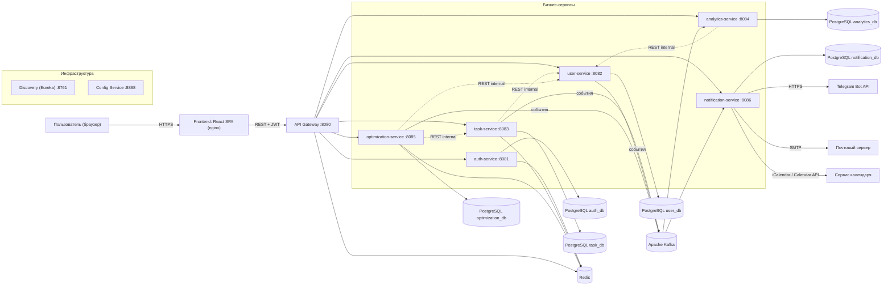
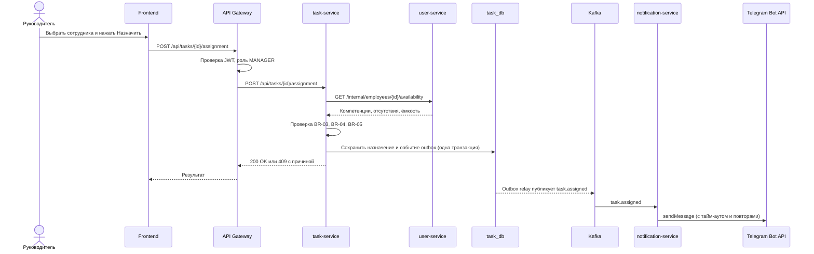
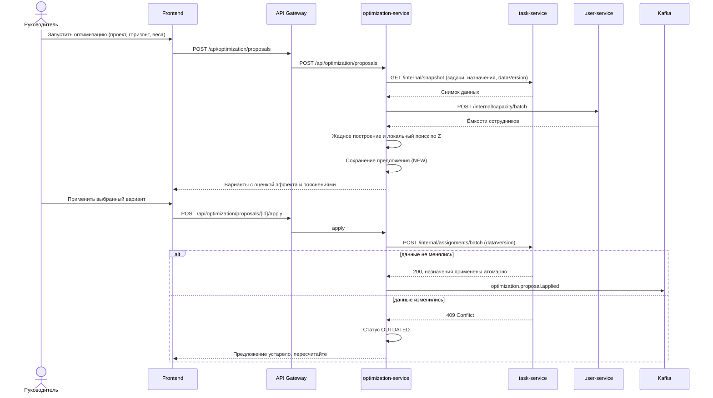

# TaskFlow Planner — архитектура приложения

Программное средство планирования деятельности сотрудников с модулем анализа и оптимизации распределения задач и рабочего времени.

**Основа:** проект по дисциплине СТСР (TaskFlow Orchestrator) + требования главы 1 курсового проекта (20 вариантов использования, 26 функциональных требований, нефункциональные требования по ISO/IEC 25010:2023).

**Условные пометки в документе**

| Пометка | Значение |
| --- | --- |
| `[СТСР]` | уже было в проекте TaskFlow Orchestrator (по методическому пособию) |
| `[НОВОЕ]` | добавляется для ИИСиК (планирование ёмкости, отсутствия, оптимизация и т. д.) |
| `[УТОЧНИТЬ]` | решение зависит от того, как реализовано в твоём коде; проверь и поправь |

> Документ описывает целевую архитектуру. Всё, что помечено `[НОВОЕ]` или `[УТОЧНИТЬ]`, нужно сверить с реальным репозиторием перед тем, как переносить в пояснительную записку.

---

## 1. Обзор

### 1.1 Архитектурный стиль

- **Микросервисы** на Java. Каждый сервис — самостоятельное Spring Boot-приложение со своей бизнес-логикой, конфигурацией и хранилищем (принцип *Database per Service*).
- **Единая точка входа** — API Gateway. Клиент (React SPA) знает только адрес Gateway.
- **Гибридное взаимодействие:** синхронные REST-вызовы там, где нужен немедленный ответ (проверка допустимости назначения, расчёт ёмкости), и асинхронные события через Apache Kafka там, где нужна слабая связанность (уведомления, аналитика, журнал).
- **Инфраструктурные сервисы:** Discovery (Eureka) и Config Service `[СТСР]`.
- **Фронтенд:** SPA на React + TypeScript, архитектура **Feature-Sliced Design**.
- **Развёртывание:** Docker + Docker Compose для локальной среды, Kubernetes как целевая оркестрация `[СТСР]`.

### 1.2 Принципы

1. Один сервис — одна зона ответственности (принцип единственной ответственности).
2. Сервис не обращается к базе данных другого сервиса; только через API или события.
3. Решение об изменении назначений принимает человек: модуль оптимизации только **предлагает** (BR-08).
4. Данные, критичные к целостности (задачи, назначения, графики, учётные записи), хранятся в реляционной БД PostgreSQL.
5. Всё конфигурируемое (веса целевой функции, коэффициент полезного времени, пороги) — параметры, а не константы в коде (FR-26).
6. Внутренние эндпоинты (`/internal/**`) недоступны снаружи через Gateway.

### 1.3 Контейнерная схема



---

## 2. Технологический стек

### 2.1 Backend

| Назначение | Технология | Комментарий |
| --- | --- | --- |
| Язык | **Java 21 (LTS)** `[СТСР]` | стабильность, производительность, виртуальные потоки доступны |
| Фреймворк | **Spring Boot 3.x** `[СТСР]` | автоконфигурация, встроенный сервер, Actuator |
| API Gateway | **Spring Cloud Gateway** `[СТСР]` | маршрутизация, предварительная проверка JWT, CORS, ограничение частоты запросов |
| Service Discovery | **Spring Cloud Netflix Eureka** `[СТСР]` | регистрация по логическому имени |
| Централизованная конфигурация | **Spring Cloud Config** `[СТСР]` | настройки без пересборки |
| Безопасность | **Spring Security + JWT** `[СТСР]` | stateless-аутентификация, RBAC |
| Хеширование паролей | **BCrypt** | BR-12, SC-2 |
| Доступ к данным | **Spring Data JPA (Hibernate)** | репозитории, транзакции, оптимистичные блокировки |
| Миграции БД | **Flyway** `[НОВОЕ]` | версионирование схемы в каждом сервисе |
| Межсервисные HTTP-вызовы | **Spring Cloud OpenFeign** или `RestClient` `[УТОЧНИТЬ]` | клиенты для `/internal/**` |
| Отказоустойчивость | **Resilience4j** `[НОВОЕ]` | тайм-ауты, повторы, circuit breaker, bulkhead (API-5, RL-1) |
| События | **Apache Kafka + Spring for Apache Kafka** `[СТСР]` | асинхронный обмен |
| Маппинг DTO | **MapStruct** `[УТОЧНИТЬ]` | пакет `mapper` |
| Валидация | **Jakarta Bean Validation** | UI-7: повторная проверка на сервере |
| Документация API | **springdoc-openapi** | API-1: контракт OpenAPI у каждого сервиса |
| Метрики и мониторинг | **Spring Boot Actuator + Micrometer + Prometheus + Grafana** | `/actuator/health` `[СТСР]`, метрики `[НОВОЕ]` |
| Трассировка | **Micrometer Tracing / OpenTelemetry** `[НОВОЕ]` | сквозной `traceId` в логах |
| Сборка | **Maven** (или Gradle) `[УТОЧНИТЬ]` | |
| Тестирование | **JUnit 5, Mockito, Testcontainers** `[НОВОЕ]` | PostgreSQL, Kafka, Redis в контейнерах |

### 2.2 Данные

| Хранилище | Где используется | Зачем |
| --- | --- | --- |
| **PostgreSQL** | все бизнес-сервисы (своя БД или схема на сервис) | строгая схема, транзакции, внешние ключи, 3НФ; требование бланка: основные данные в реляционной БД, не менее 10 таблиц |
| **Redis** `[СТСР]` | auth (refresh-токены, чёрный список), gateway (rate limit), task и optimization (кэш справочников и ёмкости) | скорость, снижение нагрузки на БД |
| **Apache Kafka (+ Zookeeper или KRaft)** `[СТСР]` | события между сервисами | слабая связанность, согласованность в конечном счёте |
| **MongoDB** `[СТСР]` | в старом проекте: задачи и аналитика | **для ИИСиК не используется**, см. раздел 9 |
| **MinIO** `[СТСР]` | в старом проекте: хранилище файлов | в ИИСиК вложения не требуются; можно оставить в Compose или убрать `[УТОЧНИТЬ]` |

### 2.3 Frontend

| Назначение | Технология |
| --- | --- |
| Библиотека UI | **React** (компонентный подход) `[СТСР]` |
| Язык | **TypeScript** `[СТСР]` |
| Сборка и dev-сервер | **Vite** `[СТСР]` |
| Маршрутизация | **React Router** `[СТСР]` |
| Серверное состояние и кэш | **TanStack Query (React Query)** `[СТСР]` |
| Архитектура кода | **Feature-Sliced Design** `[СТСР]` |
| Формы и валидация | React Hook Form + Zod `[НОВОЕ, УТОЧНИТЬ]` |
| UI-кит | Ant Design или MUI `[УТОЧНИТЬ]` |
| Графики | Recharts (или аналог) `[НОВОЕ]` |
| Календарь и временная шкала | FullCalendar (или аналог) `[НОВОЕ]` |
| Тесты | Vitest + React Testing Library; Playwright для сквозных сценариев `[НОВОЕ]` |
| Качество кода | ESLint, Prettier, TypeScript strict, Steiger (линтер FSD) `[НОВОЕ]` |

### 2.4 Инфраструктура и эксплуатация

| Назначение | Технология |
| --- | --- |
| Контейнеризация | **Docker** (multi-stage сборка) `[СТСР]` |
| Локальная оркестрация | **Docker Compose** (`depends_on` + `healthcheck`, сеть `app-network`) `[СТСР]` |
| Целевая оркестрация | **Kubernetes** (Deployment, Service, Ingress, HPA, probes) `[СТСР]` |
| CI/CD | GitHub Actions (или GitLab CI) `[НОВОЕ, УТОЧНИТЬ]` |
| Наблюдаемость | Prometheus + Grafana, структурные JSON-логи, при необходимости Loki `[НОВОЕ]` |
| Тестирование API | **Postman** `[СТСР]` |
| IDE | IntelliJ IDEA `[СТСР]` |

---

## 3. Микросервисы

### 3.1 Сводная таблица

| Сервис | Порт | БД | Ответственность | Основные варианты использования |
| --- | --- | --- | --- | --- |
| `discovery-service` | 8761 | — | Реестр сервисов (Eureka) `[СТСР]` | — |
| `config-service` | 8888 | Git или файловое хранилище | Централизованная конфигурация `[СТСР]` | — |
| `api-gateway` | 8080 | Redis | Маршрутизация, проверка JWT, CORS, rate limit, блокировка `/internal/**` `[СТСР]` | все |
| `auth-service` | 8081 | PostgreSQL `auth_db` | Регистрация, вход, JWT access и refresh, роли `[СТСР]` | UC-1, UC-18 |
| `user-service` | 8082 | PostgreSQL `user_db` | Профили сотрудников, подразделения, компетенции, графики, нерабочие дни, отсутствия, параметры расчёта, **расчёт ёмкости** `[СТСР, расширяется]` | UC-2, UC-6, UC-15, UC-19, UC-20 |
| `task-service` | 8083 | PostgreSQL `task_db` | Проекты, задачи, зависимости, назначения, учёт времени, комментарии `[СТСР, расширяется]` | UC-3, UC-4, UC-5, UC-9, UC-10, UC-11 |
| `analytics-service` | 8084 | PostgreSQL `analytics_db` | Загрузка команды, показатели эффективности, отчёты, журнал событий `[СТСР, расширяется]` | UC-7, UC-12, UC-16 |
| `optimization-service` | 8085 | PostgreSQL `optimization_db` | Алгоритм распределения, предложения и их жизненный цикл `[НОВОЕ]` | UC-13, UC-14 |
| `notification-service` | 8086 | PostgreSQL `notification_db` | Уведомления (Telegram, e-mail, личный кабинет), экспорт в календарь `[СТСР, расширяется]` | UC-8, UC-17 |

Порты 8080–8084, 8761 и 8888 взяты из пособия по СТСР; 8085 и 8086 — новые `[НОВОЕ]`.

### 3.2 `api-gateway`

- Принимает все запросы клиента, маршрутизирует по логическому имени сервиса через Eureka.
- Проверяет подпись и срок действия JWT. При успехе добавляет заголовки `X-User-Id`, `X-User-Roles` для downstream-сервисов; клиентские значения этих заголовков отбрасываются.
- Не пропускает наружу `/internal/**`.
- Настраивает CORS для фронтенда.
- Ограничивает частоту запросов (Redis), особенно для `/api/auth/login`.
- Агрегирует Swagger UI сервисов `[НОВОЕ]`.

Таблица маршрутов:

| Путь | Сервис |
| --- | --- |
| `/api/auth/**`, `/api/users/**` | auth-service |
| `/api/employees/**`, `/api/departments/**`, `/api/skills/**`, `/api/schedules/**`, `/api/non-working-days/**`, `/api/absences/**`, `/api/settings/**` | user-service |
| `/api/projects/**`, `/api/tasks/**`, `/api/assignments/**`, `/api/time-entries/**` | task-service |
| `/api/load/**`, `/api/reports/**`, `/api/audit/**` | analytics-service |
| `/api/optimization/**` | optimization-service |
| `/api/notifications/**`, `/api/calendar/**` | notification-service |

### 3.3 `auth-service`

**Назначение:** аутентификация и авторизация.

**Таблицы `auth_db`:** `users`, `user_roles`, `refresh_tokens`.

**Ключевые операции:**

- регистрация, вход, обновление и отзыв токенов (FR-1, FR-2);
- управление пользователями, ролями, блокировкой (FR-24);
- публикация событий `user.created`, `user.blocked`.

**Токены:**

- access-токен: JWT, короткий срок жизни (например, 15 минут), содержит `sub` (id пользователя), роли;
- `users.full_name` хранит ФИО с регистрации; `GET /internal/users/{id}` отдаёт его `user-service`, чтобы профиль сотрудника создавался даже если событие Kafka ещё не дошло. Gateway этот путь снаружи не пропускает;
- refresh-токен: случайное значение, в БД хранится только хеш, передаётся в `httpOnly`-cookie; при обновлении ротация (старый аннулируется);
- чёрный список и счётчики попыток входа — в Redis.

Подробнее о безопасности — раздел 7.

### 3.4 `user-service`

**Назначение:** всё, что описывает ресурс «сотрудник» и его доступность. Это владелец данных для расчёта ёмкости.

**Таблицы `user_db`:** `departments`, `employees`, `employee_avatars`, `skills`, `employee_skills`, `work_schedules`, `non_working_days`, `absences`, `calculation_settings`.

**Ключевые операции:**

- профиль и компетенции сотрудника, уровни 0–5 (FR-3, FR-4);
- аватар: заглушка, портрет из стандартного набора (`employees.avatar_preset`) или свой файл в `employee_avatars`;
- справочники: компетенции, подразделения, графики, нерабочие дни (FR-25);
- заявки на отсутствие и их согласование (FR-8, FR-20);
- параметры расчёта: коэффициент полезного времени, веса целевой функции, пороги (FR-26);
- **расчёт ёмкости** `C_j` по формуле BR-02: часы по графику с учётом согласованных отсутствий и нерабочих дней × коэффициент полезного времени (FR-15).

**Внутренний API (`/internal/**`):**

| Эндпоинт | Для кого | Назначение |
| --- | --- | --- |
| `GET /internal/employees/{id}/availability?from&to` | task-service | доступность и компетенции для проверки назначения |
| `POST /internal/capacity/batch` | analytics, optimization | ёмкость списка сотрудников на период |
| `GET /internal/settings` | optimization, analytics | параметры расчёта |

**События:** `absence.requested`, `absence.decided`, `schedule.changed`, `settings.changed`.

### 3.5 `task-service`

**Назначение:** проекты, задачи и назначения.

**Таблицы `task_db`:** `projects`, `project_members`, `tasks`, `task_skill_requirements`, `task_dependencies`, `assignments`, `time_entries`, `task_comments`.

**Ключевые операции:**

- проекты и состав участников (FR-11);
- задачи: создание и изменение, зависимости с контролем циклов, поиск, фильтрация, сортировка (FR-5, FR-12, FR-13);
- смена статуса по допустимой схеме переходов с проверкой зависимостей (FR-6, BR-07);
- назначение исполнителя с проверкой допустимости (FR-14, BR-03 — BR-06);
- учёт времени с проверкой суточного лимита (FR-7, BR-09).

**Проверка допустимости назначения** (синхронно):

1. задача и исполнитель существуют, исполнитель — участник проекта;
2. компетенции исполнителя не ниже требуемых (BR-04) — данные из `user-service` через `availability`;
3. период задачи не пересекается с согласованным отсутствием (BR-05);
4. прогноз загрузки не превышает порог — иначе предупреждение, которое руководитель подтверждает (BR-03).

**Внутренний API:**

| Эндпоинт | Для кого | Назначение |
| --- | --- | --- |
| `GET /internal/snapshot?projectId&from&to` | optimization | задачи, требования, зависимости, текущие назначения и версия данных |
| `POST /internal/assignments/batch` | optimization | атомарное применение набора назначений с проверкой `dataVersion` |

**Согласованность:** оптимистичная блокировка (`@Version`) на задаче; поле `dataVersion` проекта увеличивается при любом изменении плана — так определяется устаревшее предложение.

**События:** `task.created`, `task.updated`, `task.status-changed`, `task.assigned`, `task.unassigned`, `timeentry.added`. Публикуются через **transactional outbox** `[НОВОЕ]`: событие записывается в таблицу `outbox_events` в той же транзакции, отдельный процесс отправляет его в Kafka. Таблица `outbox_events` — вспомогательная и в предметную модель не входит.

### 3.6 `analytics-service`

**Назначение:** расчёт и хранение аналитики, отчёты и журнал событий.

**Таблицы `analytics_db`:** `workload_snapshots` (рассчитанная загрузка по сотрудникам и периодам), `task_facts` (денормализованная читаемая модель задач для отчётов), `audit_log`.

**Ключевые операции:**

- подписывается на события `task.*`, `timeentry.*`, `absence.*`, `schedule.changed` и обновляет читаемую модель `[СТСР: агрегирует события]`;
- загрузка команды и личная загрузка: нагрузка = плановая трудоёмкость назначенных задач ÷ ёмкость (BR-03); ёмкость запрашивается у `user-service` (FR-9, FR-16);
- отчёты о загрузке и использовании времени, о соблюдении сроков и точности оценок (FR-21, FR-22);
- журнал аудита назначений, смен статусов, применённых предложений (BR-13).

**Показатели:** коэффициент загрузки, неравномерность (стандартное отклонение), доля сотрудников в зонах перегрузки и недогрузки, доля задач в срок, точность оценок, время цикла.

**Проактивные сигналы:** при пересчёте загрузки публикует `overload.risk.detected`, на которое реагирует `notification-service` (руководителю уходит сигнал о риске).

### 3.7 `optimization-service`

**Назначение:** модуль анализа и оптимизации. CPU-ёмкий, не имеет собственных данных предметной области, кроме предложений.

**Таблицы `optimization_db`:** `optimization_proposals`, `proposal_items`.

**Операции:**

| Эндпоинт | Действие |
| --- | --- |
| `POST /api/optimization/proposals` | запуск: проект, горизонт, веса (FR-17) |
| `GET /api/optimization/proposals/{id}` | просмотр вариантов с оценкой эффекта и пояснениями (FR-18) |
| `POST /api/optimization/proposals/{id}/apply` | применение (FR-19) |
| `POST /api/optimization/proposals/{id}/reject` | отклонение с комментарием |

**Алгоритм** подробно описан в разделе 6.

**Применение предложения:**

1. сервис вызывает `POST /internal/assignments/batch` у `task-service`, передавая список изменений и `dataVersion`, на котором строилось предложение;
2. `task-service` в одной транзакции проверяет версию и допустимость и применяет изменения;
3. при несовпадении версии отвечает `409 Conflict`; предложение получает статус `OUTDATED`, руководителю предлагается пересчитать (BR-08);
4. после успеха публикуется `optimization.proposal.applied`, на него реагируют аналитика (журнал) и уведомления.

Так распределённая транзакция не нужна: атомарность обеспечивает один сервис — `task-service`.

### 3.8 `notification-service`

**Назначение:** доставка сообщений и интеграции с внешними сервисами.

**Таблицы `notification_db`:** `notifications`, `notification_deliveries` (попытки доставки по каналам).

**События, на которые реагирует:** `task.assigned`, `task.updated` (изменение срока), `absence.decided`, `overload.risk.detected`, `optimization.proposal.created`.

**Каналы:**

| Канал | Технология | Комментарий |
| --- | --- | --- |
| Личный кабинет | БД + REST | всегда, независимо от внешних сервисов |
| Telegram | Telegram Bot API (HTTPS) | основной внешний канал |
| E-mail | SMTP | резервный канал |
| Календарь | iCalendar (.ics) / Calendar API | экспорт назначений (FR-23) |

**Надёжность (API-5, RL-1):** тайм-аут вызова, ограниченное число повторов с нарастающей задержкой, circuit breaker; при недоступности внешнего канала уведомление остаётся в личном кабинете, неудачные доставки уходят в Dead Letter Topic и повторяются по расписанию.

---

## 4. Данные

### 4.1 Принципы

- *Database per Service*: у каждого сервиса своя БД (отдельная база или отдельная схема на общем инстансе PostgreSQL — для локальной среды допустим один инстанс с разными базами) `[УТОЧНИТЬ]`.
- Идентификаторы — `UUID`, генерируются приложением; времена — `timestamptz` (UTC); названия таблиц и колонок — `snake_case`, таблицы во множественном числе.
- Схема приводится к третьей нормальной форме; связь «многие ко многим» оформляется отдельной таблицей (`employee_skills`, `project_members`, `task_skill_requirements`, `task_dependencies`).
- Все изменения схемы — только через миграции Flyway (`V1__init.sql`, `V2__...`), `spring.jpa.hibernate.ddl-auto=validate`.
- Между сервисами **нет внешних ключей**: ссылки на сущности другого сервиса хранятся как `UUID` без FK (например, `tasks.assignee_id` → сотрудник из `user_db`), целостность обеспечивается на уровне API и событий.

### 4.2 Состав баз

| База | Таблицы | Кол-во |
| --- | --- | --- |
| `auth_db` | `users`, `user_roles`, `refresh_tokens` | 3 |
| `user_db` | `departments`, `employees`, `employee_avatars`, `skills`, `employee_skills`, `work_schedules`, `non_working_days`, `absences`, `calculation_settings` | 9 |
| `task_db` | `projects`, `project_members`, `tasks`, `task_skill_requirements`, `task_dependencies`, `assignments`, `time_entries`, `task_comments` (+ служебная `outbox_events`) | 8 |
| `analytics_db` | `workload_snapshots`, `task_facts`, `audit_log` | 3 |
| `optimization_db` | `optimization_proposals`, `proposal_items` | 2 |
| `notification_db` | `notifications`, `notification_deliveries` | 2 |
| **Итого** | | **27** |

> Требование бланка — не менее 10 таблиц в 3НФ. Суммарно их 27. Если руководитель считает требование «в одной базе», то в `task_db` их 8, а в `user_db` ещё 9: для демонстрации можно развернуть оба сервиса на одной БД с отдельными схемами `[УТОЧНИТЬ]`.

### 4.3 Ключевые таблицы

**`user_db`**

| Таблица | Основные поля | Ограничения |
| --- | --- | --- |
| `departments` | `id`, `name`, `description` | `UNIQUE(name)` |
| `employees` | `id` = `users.id`, `full_name`, `email`, `position`, `department_id` → `departments`, `schedule_id` → `work_schedules`, `useful_time_factor`, `active`, `avatar_preset`, `use_custom_avatar`, `avatar_revision` | `CHECK(useful_time_factor > 0 AND useful_time_factor <= 1)` (BR-02). `avatar_preset` — код картинки из набора. Пустое значение и `use_custom_avatar = false` — заглушка. Своё фото при этом может оставаться сохранённым |
| `employee_avatars` | `employee_id` → `employees`, `content_type`, `data`, `original_content_type`, `original_data`, `crop_zoom`, `crop_offset_x`, `crop_offset_y` | один файл на сотрудника. `data` — готовый круг, PNG/JPEG/WebP до 1 МБ. `original_data` — исходник до 15 МБ и параметры кадра, чтобы фото можно было поправить. Строка не удаляется при выборе заглушки или портрета из набора: её показывает только `use_custom_avatar` |
| `skills` | `id`, `name`, `description` | `UNIQUE(name)` |
| `employee_skills` | `employee_id`, `skill_id`, `level` | PK `(employee_id, skill_id)`, `CHECK(level BETWEEN 0 AND 5)` |
| `work_schedules` | `id`, `name`, `type`, `hours_per_day`, `work_days` | `CHECK(hours_per_day > 0)` |
| `non_working_days` | `id`, `date`, `name`, `kind` | `UNIQUE(date)` |
| `absences` | `id`, `employee_id`, `type`, `start_date`, `end_date`, `status`, `comment`, `decided_by`, `decided_at` | `CHECK(end_date >= start_date)`, запрет пересечения согласованных периодов (exclusion constraint или проверка в сервисе) |
| `calculation_settings` | `id`, `useful_time_factor`, `overload_threshold`, `underload_threshold`, `alpha`, `beta`, `gamma`, `delta`, `horizon_days` | единственная актуальная запись |

**`task_db`**

| Таблица | Основные поля | Ограничения |
| --- | --- | --- |
| `projects` | `id`, `name`, `description`, `manager_id`, `status`, `start_date`, `end_date`, `data_version` | `data_version` растёт при каждом изменении плана |
| `project_members` | `project_id`, `employee_id`, `joined_at` | PK `(project_id, employee_id)` |
| `tasks` | `id`, `project_id`, `title`, `description`, `estimate_hours`, `priority`, `status`, `due_date`, `created_by`, `created_at`, `updated_at`, `version` | `CHECK(estimate_hours > 0)` (BR-01), `@Version` |
| `task_skill_requirements` | `task_id`, `skill_id`, `min_level` | PK `(task_id, skill_id)` |
| `task_dependencies` | `task_id`, `depends_on_task_id` | PK обеих колонок, `CHECK(task_id <> depends_on_task_id)`; циклы проверяются в сервисе |
| `assignments` | `id`, `task_id`, `employee_id`, `status`, `source` (`MANUAL`/`OPTIMIZER`), `assigned_by`, `assigned_at`, `completed_at` | **частичный уникальный индекс** `UNIQUE(task_id) WHERE status = 'ACTIVE'` — один активный исполнитель (BR-06) |
| `time_entries` | `id`, `task_id`, `employee_id`, `work_date`, `hours`, `comment` | `CHECK(hours > 0 AND hours <= 24)`, суточный итог ≤ 24 ч проверяется в сервисе (BR-09) |
| `task_comments` | `id`, `task_id`, `author_id`, `content`, `created_at` | |

**`optimization_db`**

| Таблица | Основные поля |
| --- | --- |
| `optimization_proposals` | `id`, `project_id`, `created_by`, `horizon_start`, `horizon_end`, `alpha`, `beta`, `gamma`, `delta`, `objective_value`, `status` (`NEW`/`APPLIED`/`REJECTED`/`OUTDATED`), `data_version`, `created_at` |
| `proposal_items` | `id`, `proposal_id` → `optimization_proposals`, `task_id`, `from_employee_id`, `to_employee_id`, `explanation`, `load_before`, `load_after` |

Остальные таблицы (`auth_db`, `analytics_db`, `notification_db`) устроены аналогично и описываются в проектной документации при разработке схемы.

### 4.4 Индексы

- `tasks(project_id, status)`, `tasks(due_date)`, `tasks(project_id, due_date)` — списки и фильтры (PE-1);
- `assignments(employee_id) WHERE status = 'ACTIVE'` — расчёт загрузки;
- `time_entries(employee_id, work_date)`, `time_entries(task_id)`;
- `absences(employee_id, start_date, end_date)` — расчёт ёмкости;
- `notifications(recipient_id, status, created_at DESC)`.

### 4.5 Redis

| Ключ (шаблон) | Сервис | Назначение | TTL |
| --- | --- | --- | --- |
| `auth:refresh:{hash}` | auth | активный refresh-токен, значение — `userId`; источник истины остаётся Postgres | срок жизни токена |
| `auth:refresh:revoked:{hash}` | auth | отозванный refresh до конца его срока, чтобы повтор сразу отклонялся | до истечения токена |
| `auth:blacklist:{jti}` | auth, gateway | отозванные access-токены | до истечения токена |
| `rl:{ip}:{route}` | gateway | rate limit, 300 запросов в минуту на группу маршрута; при ошибке Redis запрос пропускается | 1 минута |
| `cache:settings` | user | параметры расчёта; при изменении ключ перезаписывается | 5 минут |
| `cache:skills:{employeeId}` | user | компетенции для проверки назначения; отсутствия в этот ключ не входят | 5 минут, сброс при замене навыков |
| `cache:capacity:{employeeId}:{from}:{to}` | user | часы ёмкости за период | 5 минут, сброс при решении по отсутствию и при смене графика или коэффициента |
| `cache:capacity:index:{employeeId}` | user | набор ключей ёмкости сотрудника для сброса | 5 минут |

Профили, списки задач, уведомления и строки отсутствий не кешируются: назначение и интерфейс должны видеть их сразу.

---

## 5. Взаимодействие сервисов

### 5.1 Синхронные вызовы (REST)

| Вызов | Зачем | Защита |
| --- | --- | --- |
| task → user `GET /internal/employees/{id}/availability` | проверка допустимости назначения | тайм-аут 2 с, 1 повтор, circuit breaker, кэш в Redis |
| optimization → task `GET /internal/snapshot` | данные для расчёта | тайм-аут 5 с |
| optimization → user `POST /internal/capacity/batch` | ёмкости сотрудников | тайм-аут 5 с |
| optimization → task `POST /internal/assignments/batch` | применение предложения | без автоматических повторов, идемпотентный ключ запроса |
| analytics → user `POST /internal/capacity/batch` | расчёт загрузки | тайм-аут 5 с, кэш |

Правила: тайм-ауты обязательны; повторы только для идемпотентных запросов; на недоступность зависимости сервис отвечает понятной ошибкой `503` либо деградирует (например, предупреждение вместо блокировки), но не зависает.

### 5.2 События (Kafka)

| Топик | Продюсер | Потребители | Ключ | Когда публикуется |
| --- | --- | --- | --- | --- |
| `user.events` | auth | user, notification | `userId` | `user.created`, `user.blocked`, `user.roles-changed` |
| `task.events` | task | analytics, notification | `taskId` | `task.created`, `task.updated`, `task.status-changed`, `task.assigned`, `task.unassigned` |
| `timeentry.events` | task | analytics | `taskId` | `timeentry.added`, `timeentry.changed` |
| `absence.events` | user | analytics, notification, optimization | `employeeId` | `absence.requested`, `absence.decided` |
| `schedule.events` | user | analytics | `employeeId` | `schedule.changed`, `settings.changed` |
| `optimization.events` | optimization | analytics, notification | `proposalId` | `proposal.created`, `proposal.applied`, `proposal.rejected`, `proposal.outdated` |
| `risk.events` | analytics | notification | `employeeId` | `overload.risk.detected`, `deadline.risk.detected` |

**Формат сообщения (конверт):**

```json
{
  "eventId": "7d3c1f0e-6b1a-4a9e-9d57-0d4e7a1c2b11",
  "type": "task.assigned",
  "occurredAt": "2026-11-09T09:30:12Z",
  "producer": "task-service",
  "traceId": "b3f1c2a45d6e7f80",
  "payload": {
    "taskId": "…",
    "projectId": "…",
    "employeeId": "…",
    "assignedBy": "…",
    "source": "OPTIMIZER",
    "dueDate": "2026-11-20",
    "estimateHours": 12.0
  }
}
```

**Гарантии и обработка ошибок:**

- доставка *at-least-once*; потребители **идемпотентны** (повторное событие с тем же `eventId` не меняет результат: upsert или таблица обработанных событий);
- порядок событий одного агрегата сохраняется за счёт ключа сообщения (`taskId`, `employeeId`, …);
- ошибки обработки: несколько повторов с нарастающей задержкой, затем топик `*.DLT`; по DLT настраивается оповещение;
- схемы событий версионируются полем `type` и допускают только обратно-совместимые изменения (добавление полей).

### 5.3 Сквозной сценарий: ручное назначение (UC-11)



### 5.4 Сквозной сценарий: оптимизация (UC-13, UC-14)



### 5.5 Отказоустойчивость

| Механизм | Где | Результат |
| --- | --- | --- |
| Тайм-ауты | все межсервисные и внешние вызовы | сервис не зависает на медленной зависимости |
| Повторы с задержкой | идемпотентные чтения, внешние уведомления | переживание кратковременных сбоев |
| Circuit breaker | task→user, notification→внешние API | быстрый отказ вместо лавины ошибок |
| Bulkhead | optimization-service | тяжёлые расчёты не забирают все потоки |
| Transactional outbox | task-service, user-service | событие не теряется при падении между записью в БД и отправкой в Kafka |
| Идемпотентные потребители | analytics, notification | безопасность повторной доставки |
| Оптимистичные блокировки | task-service | защита от одновременных правок |
| `dataVersion` | task-service, optimization-service | устаревшие предложения не применяются |
| Healthchecks и перезапуск | Compose, Kubernetes | автоматическое восстановление (RL-1) |

---

## 6. Модуль анализа и оптимизации

### 6.1 Постановка

Для набора задач `i` и сотрудников `j` на горизонте планирования ищется назначение `x_ij ∈ {0, 1}`, которое минимизирует

```
Z = α·Σ m_ij·x_ij  +  β·Σ_j max(0, L_j − C_j)  +  γ·σ(U)  +  δ·Σ_i p_i·t_i
```

- `m_ij` — штраф за несоответствие компетенций;
- `L_j` — загрузка, `C_j` — ёмкость, `U_j = L_j / C_j`, `σ(U)` — стандартное отклонение загрузки по команде;
- `p_i` — приоритет, `t_i` — ожидаемое запаздывание;
- `α, β, γ, δ` — веса из параметров расчёта (FR-26).

Ограничения: у задачи один исполнитель (BR-06), компетенции не ниже требуемых (BR-04), нет назначения на период отсутствия (BR-05), учёт зависимостей. Задача — обобщённая задача о назначении (NP-трудная), поэтому используется эвристика.

### 6.2 Конвейер

1. **Сбор данных.** Снимок из `task-service` (задачи, требования, зависимости, назначения, `dataVersion`) и ёмкости из `user-service`.
2. **Фильтр допустимости.** Для каждой пары «задача — сотрудник» заранее определяется, допустимо ли назначение (компетенции, доступность в период задачи). Задача без допустимых исполнителей помечается как нераспределимая с причиной.
3. **Жадное построение.** Задачи сортируются по приоритету (убывание), сроку (возрастание), трудоёмкости (убывание). Каждая задача отдаётся допустимому сотруднику, который даёт минимальный прирост `Z`.
4. **Локальный поиск.** Окрестности «перенос задачи» и «обмен двух задач»; принимается первое улучшающее изменение; остановка — нет улучшений, достигнут лимит итераций или времени.
5. **Оценка запаздывания.** Для каждого сотрудника задачи упорядочиваются по сроку (EDD); накопленная трудоёмкость сопоставляется с накопленной ёмкостью по рабочим дням — так получается ожидаемая дата завершения и `t_i`.
6. **Формирование вариантов.** Возвращаются несколько вариантов: исходное жадное решение, улучшенное локальным поиском, при необходимости вариант с другими весами.
7. **Пояснения.** Для каждого изменения назначения вычисляются `load_before`, `load_after` и причина: лучше подходит по компетенциям, снимает перегрузку, снижает риск срыва срока.
8. **Сохранение.** Предложение со статусом `NEW`, `data_version`, значением `Z`.

### 6.3 Параметры

| Параметр | Назначение | Значение по умолчанию `[УТОЧНИТЬ]` |
| --- | --- | --- |
| `useful_time_factor` | доля времени, пригодная для задач | 0,8 |
| `overload_threshold` | порог перегрузки | 1,0 |
| `underload_threshold` | порог недогрузки | 0,5 |
| `alpha, beta, gamma, delta` | веса целевой функции | подбираются экспериментально |
| `max_iterations`, `time_limit_ms` | ограничения локального поиска | 10 000 итераций, 10–20 с |
| `seed` | воспроизводимость | фиксируется для тестов |

### 6.4 Проверка качества

- детерминированность: одинаковые данные и параметры дают одинаковый результат;
- сравнение `Z` с ручным распределением на контрольном наборе (критерий успеха из раздела 1.4.1 пояснительной записки);
- нагрузочная проверка: 200 задач и 30 сотрудников — не более 30 секунд (PE-2);
- проверка инвариантов: нет назначений без компетенций и на период отсутствия.

---

## 7. Безопасность

### 7.1 Аутентификация

1. Клиент отправляет логин и пароль на `/api/auth/login` (ограничение частоты через Redis).
2. `auth-service` проверяет учётные данные (BCrypt), выдаёт access-JWT и refresh-токен (в `httpOnly`-cookie, `Secure`, `SameSite`).
3. Клиент передаёт access-токен в заголовке `Authorization: Bearer …`.
4. Gateway проверяет подпись и срок; сервисы дополнительно проверяют права по ролям.
5. При истечении access-токена клиент обращается к `/api/auth/refresh`; refresh-токен ротируется, старый аннулируется.
6. Выход (`/api/auth/logout`) аннулирует refresh-токен и добавляет `jti` access-токена в чёрный список.

Содержимое access-токена: `sub` (id пользователя), `roles`, `iat`, `exp`, `jti`.

### 7.2 Авторизация (RBAC)

| Область | ADMIN | MANAGER | EMPLOYEE |
| --- | :---: | :---: | :---: |
| Пользователи и роли | + | – | – |
| Справочники, параметры расчёта | + | чтение | чтение |
| Проекты | чтение | + (свои) | чтение (участие) |
| Создание и редактирование задач | – | + (свои проекты) | – |
| Назначение исполнителя | – | + | – |
| Свои задачи и смена статуса | – | + | + |
| Учёт времени | – | чтение по команде | + (свои задачи) |
| Заявки на отсутствие | – | согласование | подача (свои) |
| Загрузка | – | команда | своя |
| Оптимизация: запуск, применение | – | + | – |
| Отчёты | – | + | – |
| Журнал событий | + | – | – |

Дополнительно на уровне данных: сотрудник видит только свои задачи и свою загрузку; руководитель — данные своих проектов и подразделения (BR-11).

### 7.3 Межсервисная безопасность

- `/internal/**` не маршрутизируется через Gateway и доступен только внутри сети Compose (`app-network`) или кластера Kubernetes (NetworkPolicy);
- внутренние вызовы подписываются служебным токеном (JWT с `iss`/`aud` сервиса) либо передают общий секрет через `X-Internal-Token` `[УТОЧНИТЬ]`;
- заголовки `X-User-Id`, `X-User-Roles`, приходящие от клиента, Gateway удаляет и выставляет собственные.

### 7.4 Прочие меры

| Угроза | Мера |
| --- | --- |
| Перебор паролей | rate limit, временная блокировка после серии неудач, политика сложности пароля |
| SQL-инъекции | JPA/параметризованные запросы, без конкатенации SQL (SC-4) |
| XSS | экранирование в React, запрет `dangerouslySetInnerHTML`, заголовок CSP |
| CSRF | refresh-cookie только на пути `/api/auth`, `SameSite`, access-токен в заголовке |
| Утечки секретов | переменные окружения и Secrets, шифрование значений в Config Service, не хранить секреты в Git |
| Передача данных | HTTPS на внешней границе (nginx или Ingress, SSL-сертификат) (API-4) |
| Аудит | журнал назначений, смен статусов, применённых предложений (BR-13, SC-5) |

---

## 8. API и соглашения

### 8.1 Общие правила

- REST, JSON, UTF-8; идентификаторы `UUID`; даты — ISO-8601; общий префикс `/api`, несовместимые изменения — через `/api/v2`.
- Список: `GET /api/tasks?projectId=&status=&assigneeId=&dueTo=&q=&page=0&size=20&sort=dueDate,asc`; ответ:
  ```json
  { "content": [], "page": 0, "size": 20, "totalElements": 0, "totalPages": 0 }
  ```
- Ошибки в формате RFC 7807 (`application/problem+json`):
  ```json
  { "type": "about:blank", "title": "Назначение недопустимо", "status": 409,
    "code": "ASSIGNMENT_NOT_ALLOWED", "detail": "Нет компетенции «PostgreSQL» уровня 3",
    "traceId": "b3f1c2a45d6e7f80", "errors": [] }
  ```
- Коды ответов: `200/201/204`, `400` (валидация), `401`, `403`, `404`, `409` (нарушение бизнес-правила или устаревшее предложение), `429`, `503`.
- Контракт каждого сервиса публикуется в OpenAPI; Gateway объединяет Swagger UI.

### 8.2 Основные эндпоинты

| Метод и путь | Сервис | Требование |
| --- | --- | --- |
| `POST /api/auth/login`, `/refresh`, `/logout` | auth | FR-1, FR-2 |
| `GET/POST/PATCH /api/users`, `PUT /api/users/{id}/roles`, `POST /api/users/{id}/block` | auth | FR-24 |
| `GET/PATCH /api/employees/me`, `PUT /api/employees/me/avatar`, `PUT /api/employees/me/avatar-preset`, `DELETE /api/employees/me/avatar`, `GET /api/employees/{id}/avatar`, `PUT /api/employees/{id}/skills` | user | FR-3, FR-4 |
| `GET/POST/PUT/DELETE /api/skills`, `/departments`, `/schedules`, `/non-working-days` | user | FR-25 |
| `POST /api/absences`, `GET /api/absences`, `POST /api/absences/{id}/approve`, `/reject` | user | FR-8, FR-20 |
| `GET/PUT /api/settings` | user | FR-26 |
| `GET/POST/PATCH /api/projects`, `POST /api/projects/{id}/archive`, `PUT /api/projects/{id}/members` | task | FR-11 |
| `GET/POST/PATCH/DELETE /api/tasks`, `POST /api/tasks/{id}/dependencies` | task | FR-5, FR-12, FR-13 |
| `POST /api/tasks/{id}/status` | task | FR-6 |
| `POST/DELETE /api/tasks/{id}/assignment` | task | FR-14 |
| `POST /api/tasks/{id}/time-entries`, `GET /api/tasks/{id}/time-entries` | task | FR-7 |
| `GET /api/load/me`, `GET /api/load/team?projectId=&from=&to=` | analytics | FR-9, FR-15, FR-16 |
| `GET /api/reports/load`, `GET /api/reports/deadlines` | analytics | FR-21, FR-22 |
| `POST /api/optimization/proposals`, `GET …/{id}`, `POST …/{id}/apply`, `POST …/{id}/reject` | optimization | FR-17 – FR-19 |
| `GET /api/notifications`, `POST /api/notifications/{id}/read` | notification | FR-10 |
| `GET /api/calendar/export?employeeId=&from=&to=` | notification | FR-23 |

---

## 9. Изменения относительно проекта СТСР (TaskFlow Orchestrator)

| Что | Было (СТСР) | Стало (ИИСиК) | Почему |
| --- | --- | --- | --- |
| Хранение задач | MongoDB (документы) | PostgreSQL `task_db` | связи, ограничения целостности, транзакции (атомарное применение назначений); бланк требует реляционную БД |
| Хранение аналитики | MongoDB | PostgreSQL `analytics_db` | отчёты и агрегаты удобнее строить SQL-запросами |
| `user-service` | профили пользователей | профили + компетенции, графики, нерабочие дни, отсутствия, параметры, расчёт ёмкости | владелец данных о доступности ресурса |
| `task-service` | задачи, доски, колонки | проекты, задачи, зависимости, назначения, учёт времени | предметная область планирования; доски и колонки — представление статусов во фронтенде `[УТОЧНИТЬ]` |
| `analytics-service` | агрегация событий | + загрузка, показатели, отчёты, журнал | модуль анализа |
| `optimization-service` | — | новый сервис | модуль оптимизации распределения |
| `notification-service` | email, push | личный кабинет, Telegram, e-mail, экспорт в календарь | требования FR-10, FR-23, API-2, API-3 |
| Топики Kafka | события задач | + пользователи, время, отсутствия, графики, оптимизация, риски | |
| Надёжность событий | — | transactional outbox, идемпотентные потребители, DLT | RL-1, RL-2 |
| Отказоустойчивость HTTP | — | Resilience4j | API-5 |
| Миграции | — | Flyway | воспроизводимая схема |
| Порты | 8080–8084, 8761, 8888 | + 8085, 8086 | два новых сервиса |
| MinIO | есть в Compose | не используется | вложений нет `[УТОЧНИТЬ]` |
| Фронтенд | слои `app`, `features`, `shared` | полный FSD: `app`, `pages`, `widgets`, `features`, `entities`, `shared` | рост числа экранов и сценариев |
| Версия JDK | в теоретической части Java 21, в разделе установки JDK 17 | единая Java 21 | устранить расхождение в пособии `[УТОЧНИТЬ]` |

---

## 10. Frontend

### 10.1 Принципы

- Одностраничное приложение (SPA). Все запросы идут на API Gateway; внутренняя структура backend клиенту неизвестна `[СТСР]`.
- Код организован по Feature-Sliced Design: по функциональным областям, а не по техническим слоям `[СТСР]`.
- Серверное состояние (данные с API) — в TanStack Query; локальное UI-состояние — в компонентах или лёгком сторе (Zustand) `[УТОЧНИТЬ]`.
- JWT хранится в памяти приложения, refresh-токен — в `httpOnly`-cookie; чувствительные данные (пароли) не хранятся `[СТСР]`.
- Строгий TypeScript: типы DTO описывают контракты API и ловят ошибки на этапе компиляции `[СТСР]`.

### 10.2 Слои FSD

Импорты разрешены только сверху вниз: `app → pages → widgets → features → entities → shared`. Слайсы одного слоя друг на друга не ссылаются.

| Слой | Назначение | Слайсы проекта |
| --- | --- | --- |
| `app` | инициализация: провайдеры (Router, QueryClient, Auth), глобальные стили, маршрутизация, защита маршрутов | — |
| `pages` | экраны, собираемые из виджетов | `login`, `my-tasks`, `projects`, `project-board`, `task-details`, `team-load`, `optimization`, `time-tracking`, `absences`, `reports`, `notifications`, `admin-users`, `admin-dictionaries`, `settings` |
| `widgets` | самостоятельные блоки интерфейса | `app-header`, `sidebar`, `task-board`, `task-table`, `team-load-heatmap`, `personal-calendar`, `proposal-viewer`, `load-chart`, `report-view`, `absence-queue` |
| `features` | пользовательские действия с бизнес-смыслом | `auth-login`, `create-task`, `edit-task`, `change-task-status`, `add-task-dependency`, `assign-executor`, `run-optimization`, `apply-proposal`, `reject-proposal`, `add-time-entry`, `request-absence`, `decide-absence`, `edit-skills`, `export-calendar`, `filter-tasks`, `manage-users` |
| `entities` | бизнес-сущности: типы, запросы, карточки | `user`, `employee`, `skill`, `project`, `task`, `assignment`, `absence`, `proposal`, `notification`, `load` |
| `shared` | переиспользуемое без бизнес-логики | `api` (клиент, интерцепторы), `ui` (кнопки, поля, таблицы), `lib` (даты, форматирование, хуки), `config`, `types`, `routes` |

Структура слайса (сегменты): `ui/` (компоненты), `model/` (хуки, состояние, схемы), `api/` (запросы), `lib/` (хелперы), публичный интерфейс — `index.ts`.

Пример:

```
src/
├── app/
│   ├── providers/            # QueryClientProvider, AuthProvider, ThemeProvider
│   ├── router/               # маршруты, ProtectedRoute, RoleGuard
│   └── styles/
├── pages/
│   └── team-load/
│       ├── ui/TeamLoadPage.tsx
│       └── index.ts
├── widgets/
│   └── team-load-heatmap/
├── features/
│   └── run-optimization/
│       ├── ui/RunOptimizationForm.tsx
│       ├── model/useRunOptimization.ts
│       ├── api/runOptimization.ts
│       └── index.ts
├── entities/
│   └── task/
│       ├── model/types.ts    # Task, TaskStatus, Priority
│       ├── api/taskApi.ts
│       └── ui/TaskCard.tsx
└── shared/
    ├── api/httpClient.ts     # базовый URL, Authorization, refresh при 401
    ├── ui/
    └── lib/
```

### 10.3 Маршрутизация и роли

- React Router, защищённые маршруты: при отсутствии корректного токена — переход на `/login` `[СТСР]`.
- `RoleGuard` скрывает страницы и пункты меню, недоступные роли (UI-4); окончательная проверка всё равно на сервере.

| Маршрут | Роли |
| --- | --- |
| `/login` | все |
| `/my-tasks`, `/time-tracking`, `/absences`, `/notifications` | EMPLOYEE, MANAGER |
| `/projects`, `/projects/:id`, `/tasks/:id`, `/team-load`, `/optimization`, `/reports` | MANAGER |
| `/admin/users`, `/admin/dictionaries`, `/settings` | ADMIN |

### 10.4 Работа с API

- Единый HTTP-клиент: подстановка `Authorization: Bearer …`, при ответе `401` — один запрос на `/api/auth/refresh` и повтор исходного запроса; при неудаче — выход.
- TanStack Query: ключи запросов по сущностям (`['tasks', filters]`, `['load', 'team', projectId, period]`); после мутаций — инвалидация связанных ключей (после назначения — задачи и загрузка).
- Ошибки сервера (`application/problem+json`) преобразуются в понятные сообщения с указанием поля (IC-2, UI-6); `409` при назначении показывает причину и предлагает действие (подтвердить при перегрузке, выбрать другого).
- Для долгих операций (оптимизация) — индикатор прогресса и опрос статуса предложения.

### 10.5 Ключевые экраны

| Экран | Назначение | Компоненты |
| --- | --- | --- |
| Мои задачи | список и канбан по статусам, поиск, фильтры, смена статуса | `task-table`, `task-board`, `filter-tasks`, `change-task-status` |
| Загрузка команды | тепловая карта сотрудников по дням и неделям, индикация перегрузки и недогрузки (цвет + значок + текст, IC-3) | `team-load-heatmap`, `load-chart` |
| Оптимизация | выбор проекта, горизонта и весов; просмотр вариантов с оценкой эффекта и пояснениями; применить или отклонить | `run-optimization`, `proposal-viewer`, `apply-proposal`, `reject-proposal` |
| Учёт времени | ввод часов по задачам, итоги за день и неделю | `add-time-entry` |
| Отсутствия | подача заявки сотрудником, очередь согласования руководителем | `request-absence`, `absence-queue`, `decide-absence` |
| Отчёты | загрузка, сроки, точность оценок | `report-view` |

### 10.6 Качество

- TypeScript strict, ESLint, Prettier, линтер границ слоёв FSD (Steiger);
- модульные тесты Vitest + React Testing Library для `model`-логики и ключевых компонентов, сквозные сценарии Playwright (вход → создание задачи → назначение → оптимизация);
- доступность: контраст не ниже уровня AA по WCAG 2.1 (IC-3), не передавать смысл только цветом;
- сборка: `vite build`, раздача статических файлов через nginx с fallback на `index.html`.

---

## 11. Инфраструктура и развёртывание

### 11.1 Контейнеризация

- Каждый микросервис собирается в свой образ (multi-stage: сборка Maven → лёгкий образ с JRE 21) `[СТСР]`.
- Фронтенд: сборка Vite → образ nginx со статикой, `/api` проксируется на Gateway (так в браузере нет проблем с CORS).
- Конфигурация — только через переменные окружения и Config Service.

### 11.2 Docker Compose (локальная среда)

Единый `docker-compose.yml` запускает всё одной командой `docker-compose up -d` `[СТСР]`. Сеть `app-network` создаётся автоматически; контейнеры обращаются друг к другу по имени сервиса. Порядок запуска задаётся `depends_on` с условием `service_healthy` и `healthcheck`.

Порядок:

1. Инфраструктура: PostgreSQL, Redis, Zookeeper → Kafka.
2. `discovery-service`, затем `config-service`.
3. Бизнес-сервисы: `auth`, `user`, `task`, `analytics`, `optimization`, `notification`.
4. `api-gateway`.
5. `frontend`.
6. Наблюдаемость (по профилю): Prometheus, Grafana.

Фрагмент:

```yaml
services:
  postgres:
    image: postgres:16
    environment: { POSTGRES_PASSWORD: ${POSTGRES_PASSWORD} }
    healthcheck: { test: ["CMD-SHELL", "pg_isready -U postgres"], interval: 5s, retries: 10 }
    networks: [app-network]

  discovery-service:
    build: ./backend/discovery-service
    ports: ["8761:8761"]
    healthcheck: { test: ["CMD", "curl", "-f", "http://localhost:8761/actuator/health"], interval: 10s, retries: 10 }
    networks: [app-network]

  task-service:
    build: ./backend/task-service
    environment:
      SPRING_DATASOURCE_URL: jdbc:postgresql://postgres:5432/task_db
      SPRING_KAFKA_BOOTSTRAP_SERVERS: kafka:9092
      EUREKA_CLIENT_SERVICEURL_DEFAULTZONE: http://discovery-service:8761/eureka
      CONFIG_SERVER_URL: http://config-service:8888
    depends_on:
      postgres: { condition: service_healthy }
      kafka: { condition: service_healthy }
      config-service: { condition: service_healthy }
    networks: [app-network]

networks:
  app-network:
```

### 11.3 Порты

| Компонент | Порт |
| --- | --- |
| Frontend (nginx) | 80 (dev-сервер Vite — 5173) |
| API Gateway | 8080 |
| auth / user / task / analytics | 8081 / 8082 / 8083 / 8084 |
| optimization / notification | 8085 / 8086 |
| Discovery (Eureka) | 8761 |
| Config Service | 8888 |
| PostgreSQL | 5432 |
| Redis | 6379 |
| Kafka / Zookeeper | 9092 / 2181 |
| Prometheus / Grafana | 9090 / 3000 |

### 11.4 Основные переменные окружения

| Переменная | Назначение |
| --- | --- |
| `EUREKA_CLIENT_SERVICEURL_DEFAULTZONE` | адрес Eureka `[СТСР]` |
| `CONFIG_SERVER_URL` | адрес Config Service `[СТСР]` |
| `SPRING_DATASOURCE_URL`, `SPRING_DATASOURCE_USERNAME`, `SPRING_DATASOURCE_PASSWORD` | подключение к PostgreSQL `[СТСР]` |
| `SPRING_KAFKA_BOOTSTRAP_SERVERS` | брокер Kafka `[СТСР]` |
| `SPRING_DATA_REDIS_HOST`, `SPRING_DATA_REDIS_PORT` | Redis `[НОВОЕ]` |
| `JWT_SECRET`, `JWT_ACCESS_TTL`, `JWT_REFRESH_TTL` | параметры токенов `[НОВОЕ]` |
| `INTERNAL_TOKEN_SECRET` | подпись внутренних вызовов `[НОВОЕ]` |
| `TELEGRAM_BOT_TOKEN` | Telegram Bot API `[НОВОЕ]` |
| `SMTP_HOST`, `SMTP_USER`, `SMTP_PASSWORD` | e-mail `[НОВОЕ]` |

### 11.5 Kubernetes (целевая платформа)

| Объект | Назначение |
| --- | --- |
| `Deployment` на каждый сервис, `Service` типа ClusterIP | запуск и сетевой доступ |
| `Ingress` | внешний вход: `/` → frontend, `/api` → gateway |
| `ConfigMap`, `Secret` | конфигурация и секреты |
| `readinessProbe`, `livenessProbe` на `/actuator/health/readiness` и `/liveness` | автоматический перезапуск, исключение неготовых подов из балансировки `[СТСР]` |
| `HorizontalPodAutoscaler` | масштабирование по нагрузке; в первую очередь `optimization-service` и `task-service` |
| `NetworkPolicy` | доступ к `/internal/**` только между сервисами |
| StatefulSet или управляемые сервисы | PostgreSQL, Kafka, Redis |

> В Kubernetes можно использовать встроенное обнаружение сервисов вместо Eureka и ConfigMap вместо Config Service. Для курсового проекта оставляем Eureka и Config Service, как в СТСР `[УТОЧНИТЬ]`.

### 11.6 CI/CD

1. Сборка и модульные тесты (`mvn verify`), линтеры и тесты фронтенда.
2. Интеграционные тесты с Testcontainers (PostgreSQL, Kafka, Redis).
3. Проверка покрытия бизнес-логики не ниже 70 % (MN-2).
4. Сборка Docker-образов, публикация в реестр.
5. Развёртывание: `docker-compose pull && docker-compose up -d` на стенде, при необходимости — применение манифестов Kubernetes.
6. Smoke-проверка `/actuator/health` всех сервисов и сценария входа.

---

## 12. Наблюдаемость и эксплуатация

| Что | Как |
| --- | --- |
| Состояние | `/actuator/health` (+ liveness и readiness) у всех сервисов `[СТСР]`; Eureka показывает регистрацию |
| Метрики | Micrometer → Prometheus → Grafana: HTTP (RPS, ошибки, задержки), JVM, пулы подключений, лаг потребителей Kafka |
| Бизнес-метрики | число созданных и применённых предложений, время расчёта оптимизации, отказы назначения по правилам, неудачные доставки уведомлений |
| Логи | JSON, уровень по сервису, в каждой записи `traceId` и `userId` (без персональных данных и секретов); просмотр `docker logs <container>` `[СТСР]` |
| Трассировка | сквозной `traceId` через Gateway, REST и Kafka (заголовки сообщений) |
| Алерты | недоступность сервиса, рост ошибок 5xx, лаг Kafka, сообщения в DLT, время расчёта оптимизации выше лимита |
| Резервное копирование | ежедневный `pg_dump` каждой БД, проверка восстановления (RL-3) |

Типовые проблемы развёртывания (конфликт портов, сервис не регистрируется в Eureka, ошибки подключения к PostgreSQL, Kafka, Config Service, 401, сеть контейнеров) описаны в методическом пособии по СТСР; для ИИСиК добавляются: недоступность Redis (деградация rate limit и кэша), `409` при применении устаревшего предложения, сообщения в DLT.

---

## 13. Тестирование

| Уровень | Что проверяем | Инструменты |
| --- | --- | --- |
| Модульные (VF-1) | расчёт ёмкости и загрузки, правила допустимости, алгоритм оптимизации, переходы статусов, проверка циклов зависимостей | JUnit 5, Mockito, AssertJ |
| Интеграционные (VF-2) | репозитории и миграции, REST-контроллеры, публикация и потребление событий, outbox | Spring Boot Test, Testcontainers |
| Контрактные | совместимость `/internal/**` между сервисами | Spring Cloud Contract или Pact `[УТОЧНИТЬ]` |
| Функциональные (VF-3) | основные сценарии каждой роли через Gateway | Postman (коллекции) `[СТСР]`, Playwright |
| Корректность расчётов (VF-4) | сравнение с эталонными значениями на контрольных примерах | параметризованные тесты |
| Сбои (VF-5) | недоступность внешних сервисов, некорректные данные, устаревшее предложение | Testcontainers + имитация отказов (WireMock) |
| Нагрузочные | PE-1 (список за 1,5 с при 5000 задач), PE-2 (200 задач и 30 сотрудников за 30 с), PE-3 (100 пользователей) | k6 или JMeter |
| Фронтенд | логика `model`, компоненты, сценарии | Vitest, React Testing Library, Playwright |

Покрытие модульными тестами строк бизнес-логики — не менее 70 % (MN-2).

---

## 14. Трассировка требований

### 14.1 Функциональные требования

| Требования | Реализация |
| --- | --- |
| FR-1, FR-2 | `auth-service`: вход, токены, refresh, выход |
| FR-3, FR-4 | `user-service`: профиль, компетенции сотрудника |
| FR-5 | `task-service`, `user-service`: поиск, фильтры, сортировка, пагинация; на фронте `filter-tasks` |
| FR-6 | `task-service`: схема переходов статусов, контроль зависимостей |
| FR-7 | `task-service`: учёт времени, суточный лимит |
| FR-8, FR-20 | `user-service`: заявка и согласование отсутствия, событие `absence.decided` |
| FR-9, FR-16 | `analytics-service`: личная и командная загрузка |
| FR-10 | `notification-service`: уведомления |
| FR-11 – FR-13 | `task-service`: проекты, задачи, зависимости |
| FR-14 | `task-service` + `user-service`: назначение с проверкой допустимости |
| FR-15 | `user-service`: расчёт ёмкости |
| FR-17, FR-18, FR-19 | `optimization-service` + `task-service`: варианты, оценка эффекта, применение |
| FR-21, FR-22 | `analytics-service`: отчёты |
| FR-23 | `notification-service`: экспорт в календарь |
| FR-24 | `auth-service`: пользователи и роли |
| FR-25, FR-26 | `user-service`: справочники и параметры расчёта |

### 14.2 Нефункциональные требования

| Характеристика (ISO/IEC 25010:2023) | Как обеспечивается |
| --- | --- |
| Функциональная пригодность (FS) | модульные тесты расчётов на контрольных примерах, единые формулы в одном сервисе (ёмкость — `user-service`) |
| Производительность (PE) | индексы (п. 4.4), пагинация, кэш в Redis, ограничение времени оптимизации, горизонтальное масштабирование |
| Совместимость (CO) | REST/JSON, современные браузеры, стандартные протоколы (HTTPS, SMTP, iCalendar) |
| Взаимодействие с пользователем (IC) | понятные ошибки с указанием поля, контраст по WCAG AA, индикация не только цветом |
| Надёжность (RL) | outbox, идемпотентность, circuit breaker, healthcheck и перезапуск, атомарное применение предложений, резервное копирование |
| Безопасность (SC) | JWT + refresh с ротацией, BCrypt, RBAC, параметризованные запросы, аудит |
| Сопровождаемость (MN) | пакеты `controller`/`service`/`repository`/`model`/`mapper`/`config`/`exception`, тесты, логи и health-проверки |
| Гибкость (FX) | Docker Compose, конфигурация через окружение и Config Service |

### 14.3 Бизнес-правила

| Правило | Где проверяется |
| --- | --- |
| BR-01, BR-06, BR-07, BR-09 | `task-service` |
| BR-02, BR-05, BR-10 | `user-service` |
| BR-03 | `analytics-service` (показатель), `task-service` (предупреждение при назначении) |
| BR-04 | `task-service` по данным `user-service`; `optimization-service` на этапе фильтра допустимости |
| BR-08 | `optimization-service` + `task-service` (применение только по команде руководителя) |
| BR-11, BR-12 | `api-gateway`, `auth-service`, сервисы данных |
| BR-13 | `analytics-service` (журнал по событиям) |

---

## 15. Структура репозитория

```
taskflow-planner/
├── backend/
│   ├── discovery-service/
│   ├── config-service/
│   ├── api-gateway/
│   ├── auth-service/
│   ├── user-service/
│   ├── task-service/
│   ├── analytics-service/
│   ├── optimization-service/
│   ├── notification-service/
│   └── common/                # события (конверт), общие DTO ошибок, утилиты (по необходимости)
├── frontend/
│   ├── src/ (app, pages, widgets, features, entities, shared)
│   ├── Dockerfile
│   └── nginx.conf
├── infra/
│   ├── docker-compose.yml
│   ├── k8s/
│   └── monitoring/            # prometheus.yml, дашборды Grafana
├── config-repo/               # файлы Config Service
├── docs/
│   ├── api/                   # экспорт OpenAPI
│   └── diagrams/
└── ARCHITECTURE.md
```

Структура одного Java-сервиса (как в модели EA):

```
com.taskflow.<service>/
├── controller/    # REST-контроллеры
├── service/       # бизнес-логика
├── repository/    # Spring Data
├── model/         # JPA-сущности и перечисления
├── dto/           # запросы и ответы
├── mapper/        # MapStruct
├── config/        # безопасность, OpenAPI, клиенты
├── exception/     # исключения и обработчик ошибок
├── integration/   # Feign/RestClient клиенты, адаптеры внешних сервисов
├── event/         # публикация и обработка событий Kafka, outbox
└── util/
```

---

## 16. Допущения и вопросы для уточнения

1. **Версии:** Java 21, Spring Boot 3.x, PostgreSQL 16, Redis 7 — приведены ориентировочно; сверь с реальным `pom.xml` и `docker-compose.yml`.
2. **Структура сервисов:** в старом проекте их 8 (Discovery, Config, Gateway, Auth, User, Task, Analytics, Notification); здесь добавлен `optimization-service`. Если оптимизацию нужно оставить внутри `analytics-service`, меняется только раздел 3.7 и один маршрут Gateway.
3. **Доски и колонки** из старого `task-service`: оставлять ли их в модели, или достаточно представления по статусам — решение зависит от того, нужен ли Kanban в интерфейсе.
4. **Один инстанс PostgreSQL с несколькими БД** или отдельные контейнеры: для курсового проекта достаточно первого варианта.
5. **Eureka и Config Service** при развёртывании в Kubernetes можно заменить штатными средствами платформы; для демонстрации оставлены.
6. **Каналы уведомлений:** Telegram и экспорт календаря обязательны для демонстрации внешних интеграций; e-mail — резервный.
7. **Внутренняя аутентификация сервисов:** служебные JWT или общий секрет — выбрать один механизм.
8. **Требование «не менее 10 таблиц»:** уточнить у руководителя, считается ли суммарно по всем БД сервисов (26) или в одной базе (в `task_db` — 8 таблиц).
