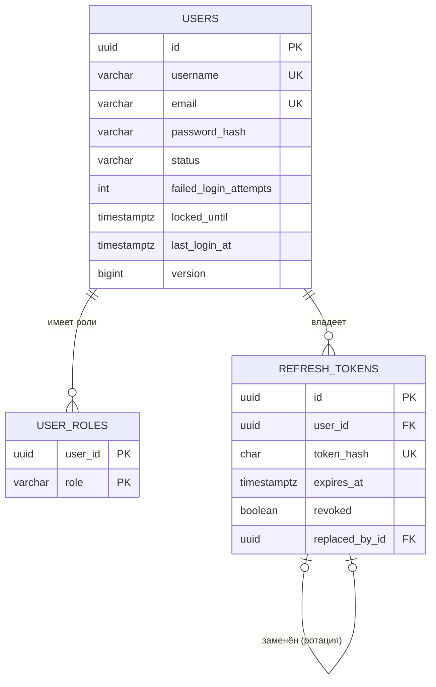
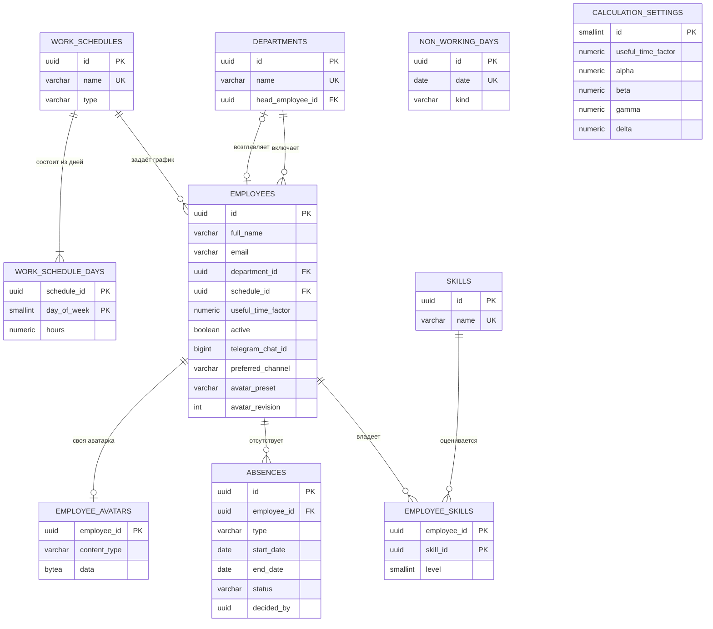
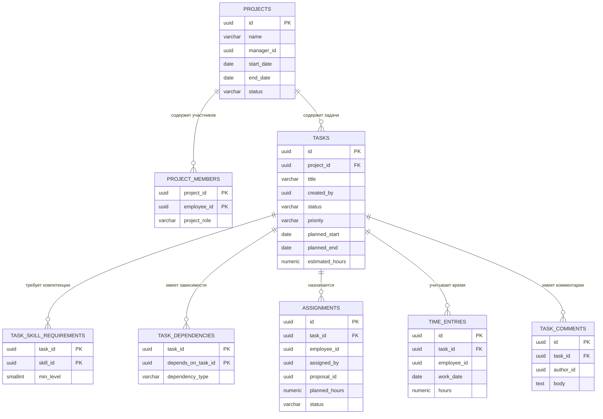
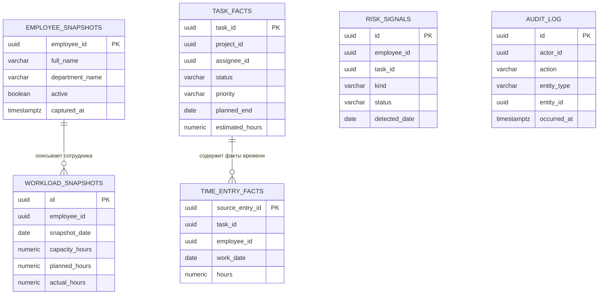
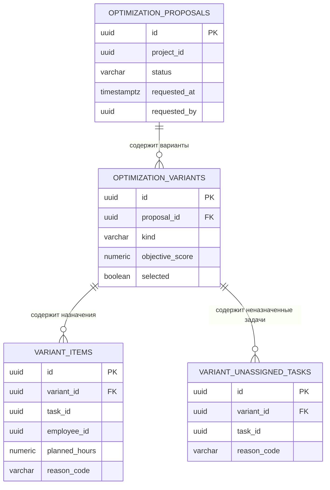
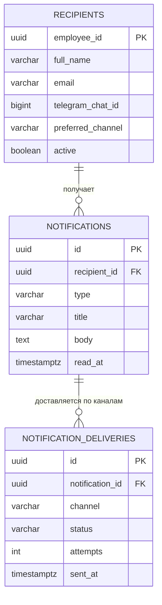

# TaskFlow Planner — базы данных, сущности и хранимые данные

Документ дополняет `ARCHITECTURE.md` (раздел 4 «Данные»). Здесь — полные схемы PostgreSQL по каждому микросервису, JPA-сущности, перечисления, словарь хранимых данных, события и ключевые SQL-запросы. DDL написан для **PostgreSQL 16** и рассчитан на перенос в миграции Flyway (`V1__init.sql`).

> **Что изменилось по сравнению с `ARCHITECTURE.md`** (при детальной проработке схем выяснилось, что нужно уточнить):
>
> | Было в `ARCHITECTURE.md` | Стало | Причина |
> | --- | --- | --- |
> | `work_schedules.work_days` (массив дней) | отдельная таблица `work_schedule_days` | первая нормальная форма; поддержка разных часов по дням (сокращённая пятница) |
> | `employees.user_id` + свой `id` | `employees.id` **совпадает** с `users.id` | единый идентификатор пользователя и сотрудника во всех сервисах и в JWT (`sub`) |
> | `optimization_proposals` + `proposal_items` | `optimization_proposals` → `optimization_variants` → `variant_items` + `variant_unassigned_tasks` | у одного запроса несколько вариантов распределения |
> | `workload_snapshots` без деталей | посуточная таблица `workload_snapshots` + `employee_snapshots`, `task_facts`, `time_entry_facts`, `risk_signals` | читаемая модель аналитики, дедупликация сигналов о рисках |
> | `notifications`, `notification_deliveries` | + `recipients` (локальная копия контактов) | уведомления не должны зависеть от доступности `user-service` |
> | `outbox_events` только в `task_db` | `outbox_events` во всех сервисах-продюсерах, `processed_events` во всех потребителях | идемпотентность и надёжная публикация |
> | 26 таблиц | **34 предметные + 9 технических** | см. раздел 1.1 |
| аватар только как файл вне БД | `employees.avatar_preset` + таблица `employee_avatars` | выбранный портрет из набора хранится кодом, своя картинка — байтами, без выбора остаётся заглушка |

---

## 1. Общие соглашения

### 1.1 Состав баз

| База (сервис) | Предметные таблицы | Технические | Всего |
| --- | --- | --- | --- |
| `auth_db` (auth-service) | `users`, `user_roles`, `refresh_tokens` — **3** | `outbox_events` | 4 |
| `user_db` (user-service) | `departments`, `work_schedules`, `work_schedule_days`, `employees`, `employee_avatars`, `skills`, `employee_skills`, `non_working_days`, `absences`, `calculation_settings` — **10** | `outbox_events`, `processed_events` | 12 |
| `task_db` (task-service) | `projects`, `project_members`, `tasks`, `task_skill_requirements`, `task_dependencies`, `assignments`, `time_entries`, `task_comments` — **8** | `outbox_events` | 9 |
| `analytics_db` (analytics-service) | `employee_snapshots`, `task_facts`, `time_entry_facts`, `workload_snapshots`, `risk_signals`, `audit_log` — **6** | `outbox_events`, `processed_events` | 8 |
| `optimization_db` (optimization-service) | `optimization_proposals`, `optimization_variants`, `variant_items`, `variant_unassigned_tasks` — **4** | `outbox_events`, `processed_events` | 6 |
| `notification_db` (notification-service) | `recipients`, `notifications`, `notification_deliveries` — **3** | `processed_events` | 4 |
| **Итого** | **34** | **9** | **43** |

Технические таблицы (`outbox_events`, `processed_events`) в предметную модель и в пояснительную записку как сущности не включаются; они описаны в разделе 9.

### 1.2 Правила

| Правило | Решение |
| --- | --- |
| Первичные ключи | `uuid`, значение по умолчанию `gen_random_uuid()` (встроено в PostgreSQL 13+); приложение может задавать ключ само |
| Идентификатор пользователя | один `uuid` на человека: `users.id` (auth) = `employees.id` (user) = `sub` в JWT = все поля «кто сделал» и «исполнитель» в других сервисах. Внешних ключей между базами нет |
| Время | `timestamptz`, хранится в UTC; даты без времени — `date` |
| Перечисления | `varchar` + `CHECK (... IN (...))`; в Java — `@Enumerated(EnumType.STRING)`. Так проще менять набор значений миграцией, чем изменять тип `enum` |
| Оптимистичная блокировка | колонка `version bigint` + `@Version` в сущностях, которые редактируют одновременно |
| Служебные поля | `created_at`, `updated_at` (обновляется триггером `set_updated_at()`) |
| Удаление | физическое там, где нет требований к истории; история ведётся состояниями (`status`, `ended_at`) и журналом `audit_log` |
| Именование | `snake_case`, таблицы во множественном числе; ограничения: `pk_`, `fk_`, `ux_` (уникальный индекс), `ix_`, `ck_`, `ex_` (exclusion) |
| Деньги и дроби | `numeric(p, s)`, не `float` |
| Нормальная форма | 3НФ; осознанные денормализации перечислены в разделе 12 |
| Расширения | `pg_trgm` (поиск по подстроке в `task_db`, `user_db`), `btree_gist` (запрет пересечения отсутствий в `user_db`) |

Общая функция для `updated_at` (создаётся в каждой базе миграцией `V1`):

```sql
CREATE OR REPLACE FUNCTION set_updated_at() RETURNS trigger AS $$
BEGIN
    NEW.updated_at := now();
    RETURN NEW;
END;
$$ LANGUAGE plpgsql;
```

### 1.3 Логические ссылки между сервисами

Внешних ключей между базами нет. Ссылки хранятся как `uuid` и проверяются через API или события.

| Колонка | Где | Указывает на | Владелец |
| --- | --- | --- | --- |
| `employees.id` | user_db | `users.id` | auth |
| `projects.manager_id`, `project_members.employee_id`, `assignments.employee_id`, `assignments.assigned_by`, `time_entries.employee_id`, `tasks.created_by`, `task_comments.author_id` | task_db | `employees.id` | user |
| `task_skill_requirements.skill_id` | task_db | `skills.id` | user |
| `assignments.proposal_id` | task_db | `optimization_proposals.id` | optimization |
| `employee_snapshots.employee_id`, `workload_snapshots.employee_id`, `task_facts.assignee_id`, `risk_signals.employee_id` | analytics_db | `employees.id` | user |
| `task_facts.task_id`, `task_facts.project_id`, `time_entry_facts.*` | analytics_db | задачи, проекты, записи времени | task |
| `optimization_proposals.project_id`, `variant_items.task_id`, `*_employee_id` | optimization_db | проекты, задачи, сотрудники | task, user |
| `notifications.recipient_id` | notification_db | `recipients.employee_id` (локальная копия `employees`) | notification |

Так как внешних ключей нет, при событии «сотрудник деактивирован» или «задача удалена» потребители сами актуализируют свои копии (раздел 10).

---

## 2. Перечисления

Значения хранятся строками. Java-перечисления называются на английском; в модели EA им соответствуют русскоязычные перечисления.

| Java-перечисление | Значения | Где используется | В EA |
| --- | --- | --- | --- |
| `Role` | `ROLE_ADMIN`, `ROLE_MANAGER`, `ROLE_EMPLOYEE` | `user_roles.role` | Роль |
| `UserStatus` | `ACTIVE`, `BLOCKED` | `users.status` | СтатусПользователя |
| `ScheduleType` | `STANDARD`, `SHORTENED`, `INDIVIDUAL` | `work_schedules.type` | ТипГрафика |
| `NonWorkingDayKind` | `HOLIDAY`, `DAY_OFF`, `TRANSFER` | `non_working_days.kind` | ТипНерабочегоДня |
| `AbsenceType` | `VACATION`, `SICK_LEAVE`, `BUSINESS_TRIP`, `STUDY_LEAVE`, `OTHER` | `absences.type` | ТипОтсутствия |
| `AbsenceStatus` | `PENDING`, `APPROVED`, `REJECTED` | `absences.status` | СтатусОтсутствия |
| `NotificationChannel` | `IN_APP`, `TELEGRAM`, `EMAIL` | `employees.preferred_channel`, `recipients.preferred_channel`, `notification_deliveries.channel` | КаналУведомления |
| `ProjectStatus` | `ACTIVE`, `ARCHIVED` | `projects.status` | СтатусПроекта |
| `TaskPriority` | `LOW`, `MEDIUM`, `HIGH`, `CRITICAL` | `tasks.priority` | ПриоритетЗадачи |
| `TaskStatus` | `CREATED`, `ASSIGNED`, `IN_PROGRESS`, `DONE`, `CANCELLED` | `tasks.status`, `task_facts.status` | СтатусЗадачи |
| `AssignmentStatus` | `ACTIVE`, `COMPLETED`, `CANCELLED` | `assignments.status` | СтатусНазначения |
| `AssignmentSource` | `MANUAL`, `OPTIMIZER` | `assignments.source` | ИсточникНазначения |
| `ProposalStatus` | `NEW`, `APPLIED`, `REJECTED`, `OUTDATED` | `optimization_proposals.status` | СтатусПредложения |
| `VariantKind` | `GREEDY`, `LOCAL_SEARCH`, `ALT_WEIGHTS` | `optimization_variants.kind` | — |
| `ChangeReason` | `INITIAL_ASSIGNMENT`, `SKILL_MATCH`, `REDUCE_OVERLOAD`, `REDUCE_DELAY_RISK`, `BALANCE_LOAD` | `variant_items.reason_code` | — |
| `UnassignedReason` | `NO_ELIGIBLE_EMPLOYEE`, `NO_CAPACITY`, `DEPENDENCY_BLOCKED` | `variant_unassigned_tasks.reason_code` | — |
| `RiskKind` | `OVERLOAD`, `DEADLINE` | `risk_signals.kind` | — |
| `RiskStatus` | `ACTIVE`, `CLEARED` | `risk_signals.status` | — |
| `NotificationType` | `ASSIGNMENT`, `DEADLINE_CHANGED`, `OVERLOAD_RISK`, `DEADLINE_RISK`, `ABSENCE_DECISION`, `OPTIMIZATION_READY` | `notifications.type` | ТипУведомления (+2 значения) |
| `DeliveryStatus` | `NEW`, `SENT`, `FAILED` | `notification_deliveries.status` | СтатусУведомления |

Допустимые переходы статуса задачи (проверяются в `task-service`; в БД — только перечень значений):

```
CREATED ──назначить──► ASSIGNED ──начать (зависимости завершены)──► IN_PROGRESS ──завершить──► DONE
   ▲                      │  ▲                                           │
   └─────снять────────────┘  └──────сменить исполнителя─────────────────┘
CREATED | ASSIGNED | IN_PROGRESS ──отменить──► CANCELLED
```

---

## 3. `auth_db` — учётные записи и токены

Назначение: хранение учётных данных, ролей и токенов обновления. Персональные данные сведены к минимуму: ФИО в `auth_db` **не хранится**, оно приходит в запросе регистрации и передаётся в событии `user.created` для создания профиля в `user-service`.

### 3.1 Диаграмма



### 3.2 DDL

```sql
-- V1__init.sql (auth_db)

CREATE TABLE users (
    id                    uuid         PRIMARY KEY DEFAULT gen_random_uuid(),
    username              varchar(64)  NOT NULL,
    email                 varchar(254) NOT NULL,
    full_name             varchar(200) NOT NULL,                 -- ФИО с регистрации, для создания профиля сотрудника
    password_hash         varchar(100) NOT NULL,                 -- BCrypt, 60 символов
    status                varchar(10)  NOT NULL DEFAULT 'ACTIVE',
    failed_login_attempts integer      NOT NULL DEFAULT 0,
    locked_until          timestamptz,
    last_login_at         timestamptz,
    created_at            timestamptz  NOT NULL DEFAULT now(),
    updated_at            timestamptz  NOT NULL DEFAULT now(),
    version               bigint       NOT NULL DEFAULT 0,
    CONSTRAINT ck_users_status CHECK (status IN ('ACTIVE', 'BLOCKED')),
    CONSTRAINT ck_users_failed CHECK (failed_login_attempts >= 0)
);
CREATE UNIQUE INDEX ux_users_username ON users (lower(username));
CREATE UNIQUE INDEX ux_users_email    ON users (lower(email));

CREATE TABLE user_roles (
    user_id uuid        NOT NULL,
    role    varchar(20) NOT NULL,
    CONSTRAINT pk_user_roles PRIMARY KEY (user_id, role),
    CONSTRAINT fk_user_roles_user FOREIGN KEY (user_id) REFERENCES users (id) ON DELETE CASCADE,
    CONSTRAINT ck_user_roles_role CHECK (role IN ('ROLE_ADMIN', 'ROLE_MANAGER', 'ROLE_EMPLOYEE'))
);

-- Тестовые пользователи, по одному на роль. Логин и пароль совпадают: 111 — администратор, 222 — руководитель, 333 — сотрудник.
-- Те же uuid заведены в user_db.employees.

CREATE TABLE refresh_tokens (
    id             uuid        PRIMARY KEY DEFAULT gen_random_uuid(),
    user_id        uuid        NOT NULL,
    token_hash     char(64)    NOT NULL,                        -- SHA-256 в hex; сам токен не хранится
    issued_at      timestamptz NOT NULL DEFAULT now(),
    expires_at     timestamptz NOT NULL,
    revoked        boolean     NOT NULL DEFAULT false,
    revoked_at     timestamptz,
    replaced_by_id uuid,                                         -- цепочка ротации
    user_agent     varchar(255),
    ip_address     varchar(45),
    CONSTRAINT fk_refresh_tokens_user FOREIGN KEY (user_id) REFERENCES users (id) ON DELETE CASCADE,
    CONSTRAINT fk_refresh_tokens_replaced FOREIGN KEY (replaced_by_id) REFERENCES refresh_tokens (id) ON DELETE SET NULL,
    CONSTRAINT ck_refresh_tokens_expiry CHECK (expires_at > issued_at),
    CONSTRAINT ck_refresh_tokens_revoked CHECK (revoked = (revoked_at IS NOT NULL))
);
CREATE UNIQUE INDEX ux_refresh_tokens_hash ON refresh_tokens (token_hash);
CREATE INDEX ix_refresh_tokens_user    ON refresh_tokens (user_id);
CREATE INDEX ix_refresh_tokens_expires ON refresh_tokens (expires_at);   -- очистка просроченных

CREATE TRIGGER trg_users_updated BEFORE UPDATE ON users
    FOR EACH ROW EXECUTE FUNCTION set_updated_at();
```

### 3.3 Какие данные хранятся

| Таблица | Что хранится | Источник истины | Персональные данные | Хранение |
| --- | --- | --- | --- | --- |
| `users` | логин, e-mail, BCrypt-хеш пароля, статус, счётчик неудачных входов | auth-service | e-mail, логин | пока учётная запись существует; при блокировке сохраняется |
| `user_roles` | роли пользователя (одна или несколько) | auth-service | — | вместе с пользователем |
| `refresh_tokens` | SHA-256 хеш токена, срок, признак отзыва, цепочка ротации | auth-service | IP, user-agent | до истечения срока + 30 дней, затем удаление заданием |

Правила:

- пароль в открытом виде и сам refresh-токен не хранятся никогда;
- при повторном использовании уже заменённого refresh-токена (признак кражи) вся цепочка отзывается;
- после N неудачных входов `locked_until` блокирует вход на заданное время (порог в конфигурации).

---

## 4. `user_db` — сотрудники, компетенции, графики, отсутствия, параметры

Назначение: владелец данных о ресурсе «сотрудник» и его доступности. Здесь вычисляется ёмкость (BR-02).

### 4.1 Диаграмма



### 4.2 DDL

```sql
-- V1__init.sql (user_db)
CREATE EXTENSION IF NOT EXISTS pg_trgm;
CREATE EXTENSION IF NOT EXISTS btree_gist;

CREATE TABLE work_schedules (
    id         uuid         PRIMARY KEY DEFAULT gen_random_uuid(),
    name       varchar(100) NOT NULL,
    type       varchar(12)  NOT NULL DEFAULT 'STANDARD',
    created_at timestamptz  NOT NULL DEFAULT now(),
    updated_at timestamptz  NOT NULL DEFAULT now(),
    version    bigint       NOT NULL DEFAULT 0,
    CONSTRAINT ux_work_schedules_name UNIQUE (name),
    CONSTRAINT ck_work_schedules_type CHECK (type IN ('STANDARD', 'SHORTENED', 'INDIVIDUAL'))
);

-- Рабочие часы по дням недели. Строки только для рабочих дней; отсутствие строки = выходной.
CREATE TABLE work_schedule_days (
    schedule_id uuid         NOT NULL,
    day_of_week smallint     NOT NULL,                           -- ISO: 1 = понедельник ... 7 = воскресенье
    hours       numeric(4,2) NOT NULL,
    CONSTRAINT pk_work_schedule_days PRIMARY KEY (schedule_id, day_of_week),
    CONSTRAINT fk_work_schedule_days_schedule FOREIGN KEY (schedule_id) REFERENCES work_schedules (id) ON DELETE CASCADE,
    CONSTRAINT ck_work_schedule_days_dow CHECK (day_of_week BETWEEN 1 AND 7),
    CONSTRAINT ck_work_schedule_days_hours CHECK (hours > 0 AND hours <= 24)
);

CREATE TABLE departments (
    id               uuid         PRIMARY KEY DEFAULT gen_random_uuid(),
    name             varchar(120) NOT NULL,
    description      varchar(500),
    head_employee_id uuid,                                       -- FK добавляется после создания employees
    created_at       timestamptz  NOT NULL DEFAULT now(),
    updated_at       timestamptz  NOT NULL DEFAULT now(),
    version          bigint       NOT NULL DEFAULT 0,
    CONSTRAINT ux_departments_name UNIQUE (name)
);

-- employees.id совпадает с users.id из auth_db (общий идентификатор), поэтому DEFAULT не задан.
CREATE TABLE employees (
    id                  uuid          PRIMARY KEY,
    full_name           varchar(200)  NOT NULL,
    email               varchar(254)  NOT NULL,
    position            varchar(120),
    department_id       uuid,
    schedule_id         uuid          NOT NULL,
    useful_time_factor  numeric(3,2)  NOT NULL DEFAULT 0.80,     -- k_j из формулы ёмкости (BR-02)
    active              boolean       NOT NULL DEFAULT true,     -- участвует в планировании
    telegram_chat_id    bigint,
    preferred_channel   varchar(10)   NOT NULL DEFAULT 'IN_APP',
    avatar_preset       varchar(40),                            -- код портрета из стандартного набора, NULL = не выбран
    use_custom_avatar   boolean       NOT NULL DEFAULT false,   -- true: показывать своё фото, файл при false не удаляется
    avatar_revision     integer       NOT NULL DEFAULT 0,       -- растёт при смене аватара, чтобы клиент обновил картинку
    created_at          timestamptz   NOT NULL DEFAULT now(),
    updated_at          timestamptz   NOT NULL DEFAULT now(),
    version             bigint        NOT NULL DEFAULT 0,
    CONSTRAINT fk_employees_department FOREIGN KEY (department_id) REFERENCES departments (id) ON DELETE SET NULL,
    CONSTRAINT fk_employees_schedule   FOREIGN KEY (schedule_id)   REFERENCES work_schedules (id),
    CONSTRAINT ck_employees_factor  CHECK (useful_time_factor > 0 AND useful_time_factor <= 1),
    CONSTRAINT ck_employees_channel CHECK (preferred_channel IN ('IN_APP', 'TELEGRAM', 'EMAIL')),
    CONSTRAINT ck_employees_avatar_revision CHECK (avatar_revision >= 0)
);
CREATE INDEX ix_employees_department ON employees (department_id);
CREATE INDEX ix_employees_active     ON employees (active);
CREATE INDEX ix_employees_name_trgm  ON employees USING gin (lower(full_name) gin_trgm_ops);

-- Своя аватарка. Строки нет — либо заглушка, либо портрет из набора (employees.avatar_preset).
-- Коды набора: 01_dragon_fruit, 02_boy_brown_hair, 03_girl_purple_hair, 04_man_beard, 05_woman_earrings, 06_girl_brown_hair, 07_man_glasses, 08_man_character, 09_coconut, 10_carrot, 11_grapes, 12_red_pepper, 13_green_apple, 14_pear, 15_pineapple, 16_blonde_girl.
-- Для уже созданной базы это же изменение применяется миграцией V3__avatars.sql.
CREATE TABLE employee_avatars (
    employee_id  uuid         PRIMARY KEY,
    content_type varchar(64)  NOT NULL,
    data                   bytea        NOT NULL,
    original_content_type  varchar(64),
    original_data          bytea,
    crop_zoom              double precision,
    crop_offset_x          double precision,
    crop_offset_y          double precision,
    updated_at             timestamptz  NOT NULL DEFAULT now(),
    CONSTRAINT fk_employee_avatars_employee FOREIGN KEY (employee_id) REFERENCES employees (id) ON DELETE CASCADE,
    CONSTRAINT ck_employee_avatars_type CHECK (content_type IN ('image/png', 'image/jpeg', 'image/webp')),
    CONSTRAINT ck_employee_avatars_size CHECK (octet_length(data) BETWEEN 1 AND 1048576),
    CONSTRAINT ck_employee_avatars_original_type CHECK (original_content_type IS NULL OR original_content_type IN ('image/png', 'image/jpeg', 'image/webp')),
    CONSTRAINT ck_employee_avatars_original_size CHECK (original_data IS NULL OR octet_length(original_data) BETWEEN 1 AND 15728640),
    CONSTRAINT ck_employee_avatars_crop_zoom CHECK (crop_zoom IS NULL OR (crop_zoom >= 1 AND crop_zoom <= 3))
);

ALTER TABLE departments
    ADD CONSTRAINT fk_departments_head FOREIGN KEY (head_employee_id) REFERENCES employees (id) ON DELETE SET NULL;

CREATE TABLE skills (
    id          uuid         PRIMARY KEY DEFAULT gen_random_uuid(),
    name        varchar(100) NOT NULL,
    description varchar(500),
    active      boolean      NOT NULL DEFAULT true,
    created_at  timestamptz  NOT NULL DEFAULT now(),
    updated_at  timestamptz  NOT NULL DEFAULT now(),
    version     bigint       NOT NULL DEFAULT 0
);
CREATE UNIQUE INDEX ux_skills_name ON skills (lower(name));

CREATE TABLE employee_skills (
    employee_id uuid        NOT NULL,
    skill_id    uuid        NOT NULL,
    level       smallint    NOT NULL,                            -- q_jk, шкала 0..5
    updated_at  timestamptz NOT NULL DEFAULT now(),
    CONSTRAINT pk_employee_skills PRIMARY KEY (employee_id, skill_id),
    CONSTRAINT fk_employee_skills_employee FOREIGN KEY (employee_id) REFERENCES employees (id) ON DELETE CASCADE,
    CONSTRAINT fk_employee_skills_skill    FOREIGN KEY (skill_id)    REFERENCES skills (id),
    CONSTRAINT ck_employee_skills_level CHECK (level BETWEEN 0 AND 5)
);
CREATE INDEX ix_employee_skills_skill ON employee_skills (skill_id, level);

CREATE TABLE non_working_days (
    id         uuid         PRIMARY KEY DEFAULT gen_random_uuid(),
    date       date         NOT NULL,
    name       varchar(150) NOT NULL,
    kind       varchar(10)  NOT NULL DEFAULT 'HOLIDAY',
    created_at timestamptz  NOT NULL DEFAULT now(),
    CONSTRAINT ux_non_working_days_date UNIQUE (date),
    CONSTRAINT ck_non_working_days_kind CHECK (kind IN ('HOLIDAY', 'DAY_OFF', 'TRANSFER'))
);

CREATE TABLE absences (
    id               uuid         PRIMARY KEY DEFAULT gen_random_uuid(),
    employee_id      uuid         NOT NULL,
    type             varchar(15)  NOT NULL,
    start_date       date         NOT NULL,
    end_date         date         NOT NULL,
    status           varchar(10)  NOT NULL DEFAULT 'PENDING',
    comment          varchar(500),
    decided_by       uuid,                                       -- employees.id руководителя
    decided_at       timestamptz,
    decision_comment varchar(500),
    created_at       timestamptz  NOT NULL DEFAULT now(),
    updated_at       timestamptz  NOT NULL DEFAULT now(),
    version          bigint       NOT NULL DEFAULT 0,
    CONSTRAINT fk_absences_employee FOREIGN KEY (employee_id) REFERENCES employees (id) ON DELETE CASCADE,
    CONSTRAINT ck_absences_type   CHECK (type IN ('VACATION', 'SICK_LEAVE', 'BUSINESS_TRIP', 'STUDY_LEAVE', 'OTHER')),
    CONSTRAINT ck_absences_status CHECK (status IN ('PENDING', 'APPROVED', 'REJECTED')),
    CONSTRAINT ck_absences_period CHECK (end_date >= start_date),
    CONSTRAINT ck_absences_decision CHECK ((status = 'PENDING') = (decided_at IS NULL)),
    -- согласованные отсутствия одного сотрудника не пересекаются
    CONSTRAINT ex_absences_no_overlap EXCLUDE USING gist (
        employee_id WITH =,
        daterange(start_date, end_date, '[]') WITH &&
    ) WHERE (status = 'APPROVED')
);
CREATE INDEX ix_absences_employee_period ON absences (employee_id, start_date, end_date);
CREATE INDEX ix_absences_status ON absences (status, start_date);

-- Единственная строка актуальных параметров (FR-26).
CREATE TABLE calculation_settings (
    id                  smallint     PRIMARY KEY DEFAULT 1,
    useful_time_factor  numeric(3,2) NOT NULL DEFAULT 0.80,     -- значение по умолчанию для новых сотрудников
    overload_threshold  numeric(4,2) NOT NULL DEFAULT 1.00,
    underload_threshold numeric(4,2) NOT NULL DEFAULT 0.50,
    alpha               numeric(8,3) NOT NULL DEFAULT 1,        -- штраф за несоответствие компетенций
    beta                numeric(8,3) NOT NULL DEFAULT 10,       -- штраф за перегрузку
    gamma               numeric(8,3) NOT NULL DEFAULT 1,        -- неравномерность загрузки
    delta               numeric(8,3) NOT NULL DEFAULT 5,        -- запаздывание
    horizon_days        integer      NOT NULL DEFAULT 14,
    updated_at          timestamptz  NOT NULL DEFAULT now(),
    updated_by          uuid,
    version             bigint       NOT NULL DEFAULT 0,
    CONSTRAINT ck_settings_single    CHECK (id = 1),
    CONSTRAINT ck_settings_factor    CHECK (useful_time_factor > 0 AND useful_time_factor <= 1),
    CONSTRAINT ck_settings_threshold CHECK (underload_threshold > 0 AND underload_threshold < overload_threshold),
    CONSTRAINT ck_settings_weights   CHECK (alpha >= 0 AND beta >= 0 AND gamma >= 0 AND delta >= 0),
    CONSTRAINT ck_settings_horizon   CHECK (horizon_days > 0)
);
INSERT INTO calculation_settings (id) VALUES (1);

CREATE TRIGGER trg_work_schedules_updated BEFORE UPDATE ON work_schedules FOR EACH ROW EXECUTE FUNCTION set_updated_at();
CREATE TRIGGER trg_departments_updated    BEFORE UPDATE ON departments    FOR EACH ROW EXECUTE FUNCTION set_updated_at();
CREATE TRIGGER trg_employees_updated      BEFORE UPDATE ON employees      FOR EACH ROW EXECUTE FUNCTION set_updated_at();
CREATE TRIGGER trg_skills_updated         BEFORE UPDATE ON skills         FOR EACH ROW EXECUTE FUNCTION set_updated_at();
CREATE TRIGGER trg_absences_updated       BEFORE UPDATE ON absences       FOR EACH ROW EXECUTE FUNCTION set_updated_at();
CREATE TRIGGER trg_settings_updated       BEFORE UPDATE ON calculation_settings FOR EACH ROW EXECUTE FUNCTION set_updated_at();
```

### 4.3 Расчёт ёмкости на стороне БД

Ёмкость сотрудника за день равна часам по его графику, если день не нерабочий и не покрыт согласованным отсутствием, умноженным на `useful_time_factor` (BR-02, FR-15):

```sql
CREATE OR REPLACE FUNCTION employee_daily_capacity(p_from date, p_to date)
RETURNS TABLE (employee_id uuid, day date, nominal_hours numeric, capacity_hours numeric)
LANGUAGE sql STABLE AS $$
    SELECT e.id,
           d.day::date,
           CASE WHEN n.id IS NOT NULL OR a.id IS NOT NULL THEN 0 ELSE COALESCE(sd.hours, 0) END,
           CASE WHEN n.id IS NOT NULL OR a.id IS NOT NULL THEN 0 ELSE COALESCE(sd.hours, 0) END * e.useful_time_factor
    FROM employees e
    CROSS JOIN generate_series(p_from, p_to, interval '1 day') AS d(day)
    LEFT JOIN work_schedule_days sd
           ON sd.schedule_id = e.schedule_id AND sd.day_of_week = extract(isodow FROM d.day)::smallint
    LEFT JOIN non_working_days n ON n.date = d.day::date
    LEFT JOIN absences a
           ON a.employee_id = e.id AND a.status = 'APPROVED' AND d.day::date BETWEEN a.start_date AND a.end_date
    WHERE e.active
$$;
```

Из-за ограничения `ex_absences_no_overlap` соединение с `absences` не размножает строки. Суммарная ёмкость на период — `SUM(capacity_hours)` по сотруднику; этот запрос обслуживает `POST /internal/capacity/batch`.

### 4.4 Какие данные хранятся

| Таблица | Что хранится | Источник истины | Персональные данные | Кто меняет |
| --- | --- | --- | --- | --- |
| `employees` | ФИО, e-mail, должность, подразделение, график, коэффициент, Telegram, предпочтительный канал, код аватара из набора (`avatar_preset`), счётчик смены аватара | user-service (создаётся по событию `user.created`) | **ФИО, e-mail, Telegram, своя аватарка** | сотрудник (профиль), администратор |
| `employee_avatars` | собственный файл аватара: PNG, JPEG или WebP, не больше 1 МБ | user-service | **изображение** | сотрудник |
| `departments` | название, описание, руководитель подразделения | user-service | — | администратор |
| `skills` | справочник компетенций | user-service | — | администратор |
| `employee_skills` | уровень владения 0–5 | user-service | — | сотрудник, руководитель, администратор |
| `work_schedules`, `work_schedule_days` | наборы рабочих часов по дням недели | user-service | — | администратор |
| `non_working_days` | праздничные и иные общие нерабочие дни | user-service | — | администратор |
| `absences` | период, тип, статус, решение руководителя | user-service | косвенно (причина отсутствия, например больничный) | сотрудник подаёт, руководитель решает |
| `calculation_settings` | коэффициент по умолчанию, пороги, веса, горизонт | user-service | — | администратор |

Событие `employee.created` / `employee.updated` публикуется при изменениях профиля, чтобы `notification-service` и `analytics-service` поддерживали локальные копии (раздел 10).

---
---

## 5. `task_db` — проекты, задачи и назначения

Назначение: источник истины по проектам, задачам, зависимостям между задачами, назначениям сотрудников и фактически затраченному времени. Сведения о сотрудниках и компетенциях хранятся в `user_db`; в `task_db` используются их UUID без межбазовых внешних ключей.

### 5.1 Диаграмма



### 5.2 DDL

```sql
-- V1__init.sql (task_db)
CREATE EXTENSION IF NOT EXISTS pg_trgm;

CREATE TABLE projects (
    id          uuid         PRIMARY KEY DEFAULT gen_random_uuid(),
    name        varchar(200) NOT NULL,
    description text,
    manager_id  uuid         NOT NULL, -- employees.id из user_db
    start_date  date         NOT NULL,
    end_date    date,
    status      varchar(10)  NOT NULL DEFAULT 'ACTIVE',
    created_at  timestamptz  NOT NULL DEFAULT now(),
    updated_at  timestamptz  NOT NULL DEFAULT now(),
    version     bigint       NOT NULL DEFAULT 0,
    CONSTRAINT ck_projects_status CHECK (status IN ('ACTIVE', 'ARCHIVED')),
    CONSTRAINT ck_projects_period CHECK (end_date IS NULL OR end_date >= start_date)
);
CREATE INDEX ix_projects_manager ON projects (manager_id);
CREATE INDEX ix_projects_status ON projects (status);
CREATE INDEX ix_projects_name_trgm ON projects USING gin (lower(name) gin_trgm_ops);

CREATE TABLE project_members (
    project_id   uuid        NOT NULL,
    employee_id  uuid        NOT NULL, -- employees.id из user_db
    project_role varchar(20) NOT NULL DEFAULT 'MEMBER',
    joined_at    timestamptz NOT NULL DEFAULT now(),
    CONSTRAINT pk_project_members PRIMARY KEY (project_id, employee_id),
    CONSTRAINT fk_project_members_project FOREIGN KEY (project_id)
        REFERENCES projects (id) ON DELETE CASCADE,
    CONSTRAINT ck_project_members_role CHECK (project_role IN ('MANAGER', 'MEMBER'))
);
CREATE INDEX ix_project_members_employee ON project_members (employee_id);

CREATE TABLE tasks (
    id              uuid          PRIMARY KEY DEFAULT gen_random_uuid(),
    project_id      uuid          NOT NULL,
    title           varchar(250)  NOT NULL,
    description     text,
    created_by      uuid          NOT NULL, -- users.id / employees.id
    status          varchar(15)   NOT NULL DEFAULT 'CREATED',
    priority        varchar(10)   NOT NULL DEFAULT 'MEDIUM',
    planned_start   date,
    planned_end     date,
    estimated_hours numeric(8,2)  NOT NULL,
    actual_hours    numeric(8,2)  NOT NULL DEFAULT 0,
    created_at      timestamptz   NOT NULL DEFAULT now(),
    updated_at      timestamptz   NOT NULL DEFAULT now(),
    version         bigint        NOT NULL DEFAULT 0,
    CONSTRAINT fk_tasks_project FOREIGN KEY (project_id)
        REFERENCES projects (id) ON DELETE CASCADE,
    CONSTRAINT ck_tasks_status CHECK (status IN ('CREATED', 'ASSIGNED', 'IN_PROGRESS', 'DONE', 'CANCELLED')),
    CONSTRAINT ck_tasks_priority CHECK (priority IN ('LOW', 'MEDIUM', 'HIGH', 'CRITICAL')),
    CONSTRAINT ck_tasks_estimated_hours CHECK (estimated_hours > 0),
    CONSTRAINT ck_tasks_actual_hours CHECK (actual_hours >= 0),
    CONSTRAINT ck_tasks_period CHECK (
        planned_start IS NULL OR planned_end IS NULL OR planned_end >= planned_start
    )
);
CREATE INDEX ix_tasks_project_status ON tasks (project_id, status);
CREATE INDEX ix_tasks_planned_end ON tasks (planned_end) WHERE status NOT IN ('DONE', 'CANCELLED');
CREATE INDEX ix_tasks_title_trgm ON tasks USING gin (lower(title) gin_trgm_ops);

CREATE TABLE task_skill_requirements (
    task_id    uuid     NOT NULL,
    skill_id   uuid     NOT NULL, -- skills.id из user_db
    min_level  smallint NOT NULL,
    CONSTRAINT pk_task_skill_requirements PRIMARY KEY (task_id, skill_id),
    CONSTRAINT fk_task_skill_requirements_task FOREIGN KEY (task_id)
        REFERENCES tasks (id) ON DELETE CASCADE,
    CONSTRAINT ck_task_skill_requirements_level CHECK (min_level BETWEEN 0 AND 5)
);
CREATE INDEX ix_task_skill_requirements_skill ON task_skill_requirements (skill_id);

CREATE TABLE task_dependencies (
    task_id            uuid        NOT NULL,
    depends_on_task_id uuid        NOT NULL,
    dependency_type    varchar(20) NOT NULL DEFAULT 'FINISH_TO_START',
    created_at         timestamptz NOT NULL DEFAULT now(),
    CONSTRAINT pk_task_dependencies PRIMARY KEY (task_id, depends_on_task_id),
    CONSTRAINT fk_task_dependencies_task FOREIGN KEY (task_id)
        REFERENCES tasks (id) ON DELETE CASCADE,
    CONSTRAINT fk_task_dependencies_parent FOREIGN KEY (depends_on_task_id)
        REFERENCES tasks (id) ON DELETE CASCADE,
    CONSTRAINT ck_task_dependencies_not_self CHECK (task_id <> depends_on_task_id),
    CONSTRAINT ck_task_dependencies_type CHECK (dependency_type IN ('FINISH_TO_START'))
);
CREATE INDEX ix_task_dependencies_parent ON task_dependencies (depends_on_task_id);

CREATE TABLE assignments (
    id           uuid          PRIMARY KEY DEFAULT gen_random_uuid(),
    task_id      uuid          NOT NULL,
    employee_id  uuid          NOT NULL, -- employees.id из user_db
    assigned_by  uuid          NOT NULL, -- users.id / employees.id
    proposal_id  uuid,                    -- optimization_proposals.id из optimization_db
    planned_hours numeric(8,2) NOT NULL,
    status       varchar(12)   NOT NULL DEFAULT 'ACTIVE',
    source       varchar(10)   NOT NULL DEFAULT 'MANUAL',
    assigned_at  timestamptz   NOT NULL DEFAULT now(),
    completed_at timestamptz,
    created_at   timestamptz   NOT NULL DEFAULT now(),
    updated_at   timestamptz   NOT NULL DEFAULT now(),
    version      bigint        NOT NULL DEFAULT 0,
    CONSTRAINT fk_assignments_task FOREIGN KEY (task_id)
        REFERENCES tasks (id) ON DELETE CASCADE,
    CONSTRAINT ck_assignments_hours CHECK (planned_hours > 0),
    CONSTRAINT ck_assignments_status CHECK (status IN ('ACTIVE', 'COMPLETED', 'CANCELLED')),
    CONSTRAINT ck_assignments_source CHECK (source IN ('MANUAL', 'OPTIMIZER')),
    CONSTRAINT ck_assignments_completion CHECK (
        (status = 'COMPLETED') = (completed_at IS NOT NULL)
    )
);
CREATE INDEX ix_assignments_task_status ON assignments (task_id, status);
CREATE INDEX ix_assignments_employee_status ON assignments (employee_id, status);
CREATE INDEX ix_assignments_proposal ON assignments (proposal_id) WHERE proposal_id IS NOT NULL;
CREATE UNIQUE INDEX ux_assignments_one_active_per_task
    ON assignments (task_id) WHERE status = 'ACTIVE';

CREATE TABLE time_entries (
    id          uuid          PRIMARY KEY DEFAULT gen_random_uuid(),
    task_id     uuid          NOT NULL,
    employee_id uuid          NOT NULL, -- employees.id из user_db
    work_date   date          NOT NULL,
    hours       numeric(6,2)  NOT NULL,
    description varchar(1000),
    created_at  timestamptz   NOT NULL DEFAULT now(),
    updated_at  timestamptz   NOT NULL DEFAULT now(),
    version     bigint        NOT NULL DEFAULT 0,
    CONSTRAINT fk_time_entries_task FOREIGN KEY (task_id)
        REFERENCES tasks (id) ON DELETE CASCADE,
    CONSTRAINT ck_time_entries_hours CHECK (hours > 0 AND hours <= 24)
);
CREATE INDEX ix_time_entries_task_date ON time_entries (task_id, work_date);
CREATE INDEX ix_time_entries_employee_date ON time_entries (employee_id, work_date);

CREATE TABLE task_comments (
    id         uuid         PRIMARY KEY DEFAULT gen_random_uuid(),
    task_id    uuid         NOT NULL,
    author_id  uuid         NOT NULL, -- users.id / employees.id
    body       varchar(5000) NOT NULL,
    created_at timestamptz  NOT NULL DEFAULT now(),
    updated_at timestamptz  NOT NULL DEFAULT now(),
    CONSTRAINT fk_task_comments_task FOREIGN KEY (task_id)
        REFERENCES tasks (id) ON DELETE CASCADE,
    CONSTRAINT ck_task_comments_body CHECK (length(trim(body)) > 0)
);
CREATE INDEX ix_task_comments_task_created ON task_comments (task_id, created_at);

CREATE TRIGGER trg_projects_updated BEFORE UPDATE ON projects
    FOR EACH ROW EXECUTE FUNCTION set_updated_at();
CREATE TRIGGER trg_tasks_updated BEFORE UPDATE ON tasks
    FOR EACH ROW EXECUTE FUNCTION set_updated_at();
CREATE TRIGGER trg_assignments_updated BEFORE UPDATE ON assignments
    FOR EACH ROW EXECUTE FUNCTION set_updated_at();
CREATE TRIGGER trg_time_entries_updated BEFORE UPDATE ON time_entries
    FOR EACH ROW EXECUTE FUNCTION set_updated_at();
CREATE TRIGGER trg_task_comments_updated BEFORE UPDATE ON task_comments
    FOR EACH ROW EXECUTE FUNCTION set_updated_at();
```

### 5.3 Какие данные хранятся

| Таблица | Что хранится | Источник истины | Персональные данные |
| --- | --- | --- | --- |
| `projects` | название, описание, руководитель, сроки и статус проекта | task-service | UUID руководителя |
| `project_members` | участники проекта и их роли | task-service | UUID сотрудника |
| `tasks` | содержание задачи, сроки, приоритет, оценка и фактические часы | task-service | UUID автора |
| `task_skill_requirements` | необходимые для задачи компетенции и минимальный уровень | task-service; справочник компетенций принадлежит user-service | — |
| `task_dependencies` | зависимости между задачами | task-service | — |
| `assignments` | исполнитель, плановые часы, источник и состояние назначения | task-service | UUID исполнителя и назначившего |
| `time_entries` | фактически затраченное время по дням | task-service | UUID сотрудника |
| `task_comments` | комментарии к задачам и авторы | task-service | UUID автора, текст комментария |

### 5.4 Основные правила целостности

- Проект не может иметь дату окончания раньше даты начала.
- Оценка трудоёмкости задачи должна быть положительной.
- Задача не может зависеть от самой себя.
- Для одной задачи допускается не более одного активного назначения; история отменённых и завершённых назначений сохраняется.
- Назначение с `source = 'OPTIMIZER'` может содержать UUID предложения оптимизации в `proposal_id`. Межбазовый FK не создаётся.
- Перед переводом задачи в `IN_PROGRESS` сервис проверяет завершение задач-предшественников.
- Сумма `time_entries.hours` используется для актуализации `tasks.actual_hours`; операция выполняется транзакционно в `task-service`.

---

## 6. `analytics_db` — аналитика, загрузка и аудит

Назначение: хранение подготовленных фактов и снимков, необходимых для расчёта загрузки сотрудников, показателей эффективности, отчётов и анализа рисков. База получает изменения из `task-service` и `user-service` через Kafka и не является источником истины для исходных задач и профилей сотрудников.

### 6.1 Диаграмма



### 6.2 DDL

```sql
-- V1__init.sql (analytics_db)

CREATE TABLE employee_snapshots (
    employee_id     uuid         PRIMARY KEY, -- employees.id из user_db
    full_name       varchar(200) NOT NULL,
    department_id   uuid,
    department_name varchar(120),
    position        varchar(120),
    active          boolean      NOT NULL,
    captured_at     timestamptz  NOT NULL DEFAULT now()
);
CREATE INDEX ix_employee_snapshots_department ON employee_snapshots (department_id);

CREATE TABLE task_facts (
    task_id         uuid         PRIMARY KEY, -- tasks.id из task_db
    project_id      uuid         NOT NULL,
    project_name    varchar(200),
    assignee_id     uuid,                     -- employees.id из user_db
    status          varchar(15)  NOT NULL,
    priority        varchar(10)  NOT NULL,
    planned_start   date,
    planned_end     date,
    estimated_hours numeric(8,2) NOT NULL,
    actual_hours    numeric(8,2) NOT NULL DEFAULT 0,
    source_updated_at timestamptz,
    captured_at     timestamptz  NOT NULL DEFAULT now(),
    CONSTRAINT ck_task_facts_status CHECK (status IN ('CREATED', 'ASSIGNED', 'IN_PROGRESS', 'DONE', 'CANCELLED')),
    CONSTRAINT ck_task_facts_priority CHECK (priority IN ('LOW', 'MEDIUM', 'HIGH', 'CRITICAL')),
    CONSTRAINT ck_task_facts_hours CHECK (estimated_hours > 0 AND actual_hours >= 0)
);
CREATE INDEX ix_task_facts_project ON task_facts (project_id);
CREATE INDEX ix_task_facts_assignee_status ON task_facts (assignee_id, status);
CREATE INDEX ix_task_facts_deadline ON task_facts (planned_end) WHERE status NOT IN ('DONE', 'CANCELLED');

CREATE TABLE time_entry_facts (
    source_entry_id uuid         PRIMARY KEY, -- time_entries.id из task_db
    task_id         uuid         NOT NULL,
    project_id      uuid         NOT NULL,
    employee_id     uuid         NOT NULL,
    work_date       date         NOT NULL,
    hours           numeric(6,2) NOT NULL,
    captured_at     timestamptz  NOT NULL DEFAULT now(),
    CONSTRAINT ck_time_entry_facts_hours CHECK (hours > 0 AND hours <= 24)
);
CREATE INDEX ix_time_entry_facts_employee_date ON time_entry_facts (employee_id, work_date);
CREATE INDEX ix_time_entry_facts_task_date ON time_entry_facts (task_id, work_date);
CREATE INDEX ix_time_entry_facts_project_date ON time_entry_facts (project_id, work_date);

CREATE TABLE workload_snapshots (
    id              uuid         PRIMARY KEY DEFAULT gen_random_uuid(),
    employee_id     uuid         NOT NULL,
    snapshot_date   date         NOT NULL,
    capacity_hours  numeric(8,2) NOT NULL,
    planned_hours   numeric(8,2) NOT NULL DEFAULT 0,
    actual_hours    numeric(8,2) NOT NULL DEFAULT 0,
    utilization     numeric(8,4),
    created_at      timestamptz  NOT NULL DEFAULT now(),
    CONSTRAINT ux_workload_employee_date UNIQUE (employee_id, snapshot_date),
    CONSTRAINT ck_workload_hours CHECK (
        capacity_hours >= 0 AND planned_hours >= 0 AND actual_hours >= 0
    ),
    CONSTRAINT ck_workload_utilization CHECK (utilization IS NULL OR utilization >= 0)
);
CREATE INDEX ix_workload_date ON workload_snapshots (snapshot_date);
CREATE INDEX ix_workload_employee_date_desc ON workload_snapshots (employee_id, snapshot_date DESC);

CREATE TABLE risk_signals (
    id            uuid         PRIMARY KEY DEFAULT gen_random_uuid(),
    employee_id   uuid,
    task_id       uuid,
    kind          varchar(10)  NOT NULL,
    status        varchar(10)  NOT NULL DEFAULT 'ACTIVE',
    detected_date date         NOT NULL DEFAULT CURRENT_DATE,
    details       jsonb        NOT NULL DEFAULT '{}'::jsonb,
    cleared_at    timestamptz,
    created_at    timestamptz  NOT NULL DEFAULT now(),
    updated_at    timestamptz  NOT NULL DEFAULT now(),
    CONSTRAINT ck_risk_signals_kind CHECK (kind IN ('OVERLOAD', 'DEADLINE')),
    CONSTRAINT ck_risk_signals_status CHECK (status IN ('ACTIVE', 'CLEARED')),
    CONSTRAINT ck_risk_signals_cleared CHECK (
        (status = 'CLEARED') = (cleared_at IS NOT NULL)
    )
);
CREATE UNIQUE INDEX ux_risk_signals_active_employee
    ON risk_signals (employee_id, detected_date, kind)
    WHERE status = 'ACTIVE' AND employee_id IS NOT NULL;
CREATE UNIQUE INDEX ux_risk_signals_active_task
    ON risk_signals (task_id, detected_date, kind)
    WHERE status = 'ACTIVE' AND task_id IS NOT NULL;
CREATE INDEX ix_risk_signals_status_date ON risk_signals (status, detected_date);

CREATE TABLE audit_log (
    id          uuid         PRIMARY KEY DEFAULT gen_random_uuid(),
    actor_id    uuid,
    action      varchar(80)  NOT NULL,
    entity_type varchar(80)  NOT NULL,
    entity_id   uuid,
    details     jsonb        NOT NULL DEFAULT '{}'::jsonb,
    occurred_at timestamptz  NOT NULL DEFAULT now(),
    CONSTRAINT ck_audit_action CHECK (length(trim(action)) > 0),
    CONSTRAINT ck_audit_entity_type CHECK (length(trim(entity_type)) > 0)
);
CREATE INDEX ix_audit_log_occurred ON audit_log (occurred_at DESC);
CREATE INDEX ix_audit_log_actor ON audit_log (actor_id, occurred_at DESC);
CREATE INDEX ix_audit_log_entity ON audit_log (entity_type, entity_id, occurred_at DESC);

CREATE TRIGGER trg_risk_signals_updated BEFORE UPDATE ON risk_signals
    FOR EACH ROW EXECUTE FUNCTION set_updated_at();
```

### 6.3 Какие данные хранятся

| Таблица | Что хранится | Источник данных | Назначение |
| --- | --- | --- | --- |
| `employee_snapshots` | локальный снимок ФИО, подразделения, должности и активности сотрудника | user-service | подписи и группировка аналитических отчётов |
| `task_facts` | состояние, сроки, приоритет и трудоёмкость задачи | task-service | анализ выполнения и просрочек |
| `time_entry_facts` | фактическое время по сотруднику, задаче и дате | task-service | отчёты по затратам времени |
| `workload_snapshots` | доступная ёмкость, плановая и фактическая загрузка на дату | user-service + task-service | динамика загрузки и выявление перегрузки |
| `risk_signals` | активные и закрытые сигналы перегрузки и риска срока | analytics-service | контроль рисков и передача уведомлений |
| `audit_log` | кто, когда и какое действие выполнил | события сервисов | аудит действий системы |

### 6.4 Расчёт показателя загрузки

Для сотрудника и даты коэффициент загрузки рассчитывается по формуле:

\[
U = \frac{H_{planned}}{H_{capacity}}
\]

где:
- \(H_{planned}\) — плановое количество часов;
- \(H_{capacity}\) — доступная ёмкость сотрудника.

Если ёмкость равна нулю, коэффициент не рассчитывается и хранится как `NULL`. Значение выше `1` означает превышение доступной ёмкости. Снимки формируются по расписанию и/или при обработке значимых событий; конкретная периодичность задаётся конфигурацией analytics-service.

---

## 7. `optimization_db` — предложения и варианты оптимизации

Назначение: хранение запусков алгоритма оптимизации, сформированных вариантов распределения задач и результатов оценки. Исходные проекты, задачи и сотрудники принадлежат соответственно `task-service` и `user-service`; в этой базе сохраняются их идентификаторы и необходимые расчётные значения.

### 7.1 Диаграмма



### 7.2 DDL

```sql
-- V1__init.sql (optimization_db)

CREATE TABLE optimization_proposals (
    id             uuid         PRIMARY KEY DEFAULT gen_random_uuid(),
    project_id     uuid         NOT NULL, -- projects.id из task_db
    status         varchar(10)  NOT NULL DEFAULT 'NEW',
    requested_by   uuid         NOT NULL,
    requested_at   timestamptz  NOT NULL DEFAULT now(),
    applied_at     timestamptz,
    rejected_at    timestamptz,
    input_snapshot jsonb        NOT NULL DEFAULT '{}'::jsonb,
    created_at     timestamptz  NOT NULL DEFAULT now(),
    updated_at     timestamptz  NOT NULL DEFAULT now(),
    version        bigint       NOT NULL DEFAULT 0,
    CONSTRAINT ck_optimization_proposals_status CHECK (
        status IN ('NEW', 'APPLIED', 'REJECTED', 'OUTDATED')
    ),
    CONSTRAINT ck_optimization_proposals_dates CHECK (
        (status = 'APPLIED') = (applied_at IS NOT NULL)
    )
);
CREATE INDEX ix_optimization_proposals_project ON optimization_proposals (project_id, requested_at DESC);
CREATE INDEX ix_optimization_proposals_status ON optimization_proposals (status, requested_at DESC);

CREATE TABLE optimization_variants (
    id              uuid          PRIMARY KEY DEFAULT gen_random_uuid(),
    proposal_id     uuid          NOT NULL,
    kind            varchar(20)   NOT NULL,
    objective_score numeric(14,4) NOT NULL,
    selected        boolean       NOT NULL DEFAULT false,
    metrics         jsonb         NOT NULL DEFAULT '{}'::jsonb,
    created_at      timestamptz   NOT NULL DEFAULT now(),
    CONSTRAINT fk_optimization_variants_proposal FOREIGN KEY (proposal_id)
        REFERENCES optimization_proposals (id) ON DELETE CASCADE,
    CONSTRAINT ck_optimization_variants_kind CHECK (
        kind IN ('GREEDY', 'LOCAL_SEARCH', 'ALT_WEIGHTS')
    )
);
CREATE INDEX ix_optimization_variants_proposal ON optimization_variants (proposal_id);
CREATE UNIQUE INDEX ux_optimization_variants_selected
    ON optimization_variants (proposal_id) WHERE selected = true;

CREATE TABLE variant_items (
    id            uuid          PRIMARY KEY DEFAULT gen_random_uuid(),
    variant_id    uuid          NOT NULL,
    task_id       uuid          NOT NULL, -- tasks.id из task_db
    employee_id   uuid          NOT NULL, -- employees.id из user_db
    planned_hours numeric(8,2)  NOT NULL,
    reason_code   varchar(30)   NOT NULL,
    explanation   varchar(1000),
    CONSTRAINT fk_variant_items_variant FOREIGN KEY (variant_id)
        REFERENCES optimization_variants (id) ON DELETE CASCADE,
    CONSTRAINT ck_variant_items_hours CHECK (planned_hours > 0),
    CONSTRAINT ck_variant_items_reason CHECK (
        reason_code IN (
            'INITIAL_ASSIGNMENT', 'SKILL_MATCH', 'REDUCE_OVERLOAD',
            'REDUCE_DELAY_RISK', 'BALANCE_LOAD'
        )
    ),
    CONSTRAINT ux_variant_items_task UNIQUE (variant_id, task_id)
);
CREATE INDEX ix_variant_items_employee ON variant_items (employee_id);

CREATE TABLE variant_unassigned_tasks (
    id          uuid         PRIMARY KEY DEFAULT gen_random_uuid(),
    variant_id  uuid         NOT NULL,
    task_id     uuid         NOT NULL, -- tasks.id из task_db
    reason_code varchar(30)  NOT NULL,
    explanation varchar(1000),
    CONSTRAINT fk_variant_unassigned_variant FOREIGN KEY (variant_id)
        REFERENCES optimization_variants (id) ON DELETE CASCADE,
    CONSTRAINT ck_variant_unassigned_reason CHECK (
        reason_code IN ('NO_ELIGIBLE_EMPLOYEE', 'NO_CAPACITY', 'DEPENDENCY_BLOCKED')
    ),
    CONSTRAINT ux_variant_unassigned_task UNIQUE (variant_id, task_id)
);
CREATE INDEX ix_variant_unassigned_task ON variant_unassigned_tasks (task_id);

CREATE TRIGGER trg_optimization_proposals_updated BEFORE UPDATE ON optimization_proposals
    FOR EACH ROW EXECUTE FUNCTION set_updated_at();
```

### 7.3 Какие данные хранятся

| Таблица | Что хранится | Источник | Назначение |
| --- | --- | --- | --- |
| `optimization_proposals` | запрос на оптимизацию, проект, инициатор, состояние и входной снимок | optimization-service | жизненный цикл запуска оптимизации |
| `optimization_variants` | варианты алгоритма, оценка целевой функции и выбранный вариант | optimization-service | сравнение результатов |
| `variant_items` | предлагаемые назначения задач сотрудникам, часы и причина выбора | optimization-service | детализация распределения |
| `variant_unassigned_tasks` | задачи, которые не удалось распределить, и причина | optimization-service | объяснение неполного результата |

### 7.4 Применение варианта

Алгоритм формирует один или несколько вариантов. Пользователь выбирает подходящий вариант, после чего `optimization-service` передаёт назначения в `task-service` через `POST /internal/assignments/batch`. Записи в `task_db` создаются именно владельцем этих данных — `task-service`. После успешного применения предложение переводится в `APPLIED`, а событие `optimization.proposal.applied` публикуется в Kafka.

---

## 8. `notification_db` — уведомления и доставка

Назначение: хранение уведомлений, адресатов и результатов доставки по каналам IN_APP, TELEGRAM и EMAIL. Локальная копия контактных данных позволяет формировать и отправлять уведомления без синхронного обращения к `user-service` в момент отправки.

### 8.1 Диаграмма



### 8.2 DDL

```sql
-- V1__init.sql (notification_db)

CREATE TABLE recipients (
    employee_id       uuid         PRIMARY KEY, -- employees.id из user_db
    full_name         varchar(200) NOT NULL,
    email             varchar(254),
    telegram_chat_id  bigint,
    preferred_channel varchar(10)  NOT NULL DEFAULT 'IN_APP',
    active            boolean      NOT NULL DEFAULT true,
    updated_at        timestamptz  NOT NULL DEFAULT now(),
    CONSTRAINT ck_recipients_channel CHECK (
        preferred_channel IN ('IN_APP', 'TELEGRAM', 'EMAIL')
    )
);
CREATE INDEX ix_recipients_active ON recipients (active);

CREATE TABLE notifications (
    id           uuid          PRIMARY KEY DEFAULT gen_random_uuid(),
    recipient_id uuid          NOT NULL,
    type         varchar(30)   NOT NULL,
    title        varchar(200)  NOT NULL,
    body         varchar(5000) NOT NULL,
    payload      jsonb         NOT NULL DEFAULT '{}'::jsonb,
    created_at   timestamptz   NOT NULL DEFAULT now(),
    read_at      timestamptz,
    CONSTRAINT fk_notifications_recipient FOREIGN KEY (recipient_id)
        REFERENCES recipients (employee_id) ON DELETE CASCADE,
    CONSTRAINT ck_notifications_type CHECK (
        type IN (
            'ASSIGNMENT', 'DEADLINE_CHANGED', 'OVERLOAD_RISK',
            'DEADLINE_RISK', 'ABSENCE_DECISION', 'OPTIMIZATION_READY'
        )
    )
);
CREATE INDEX ix_notifications_recipient_created
    ON notifications (recipient_id, created_at DESC);
CREATE INDEX ix_notifications_unread
    ON notifications (recipient_id, created_at DESC) WHERE read_at IS NULL;

CREATE TABLE notification_deliveries (
    id              uuid         PRIMARY KEY DEFAULT gen_random_uuid(),
    notification_id uuid         NOT NULL,
    channel         varchar(10)  NOT NULL,
    status          varchar(10)  NOT NULL DEFAULT 'NEW',
    attempts        integer      NOT NULL DEFAULT 0,
    last_error      varchar(2000),
    created_at      timestamptz  NOT NULL DEFAULT now(),
    sent_at         timestamptz,
    updated_at      timestamptz  NOT NULL DEFAULT now(),
    CONSTRAINT fk_notification_deliveries_notification FOREIGN KEY (notification_id)
        REFERENCES notifications (id) ON DELETE CASCADE,
    CONSTRAINT ck_notification_deliveries_channel CHECK (
        channel IN ('IN_APP', 'TELEGRAM', 'EMAIL')
    ),
    CONSTRAINT ck_notification_deliveries_status CHECK (
        status IN ('NEW', 'SENT', 'FAILED')
    ),
    CONSTRAINT ck_notification_deliveries_attempts CHECK (attempts >= 0),
    CONSTRAINT ck_notification_deliveries_sent CHECK (
        (status = 'SENT') = (sent_at IS NOT NULL)
    ),
    CONSTRAINT ux_notification_delivery_channel UNIQUE (notification_id, channel)
);
CREATE INDEX ix_notification_deliveries_status
    ON notification_deliveries (status, created_at);

CREATE TRIGGER trg_notification_deliveries_updated BEFORE UPDATE ON notification_deliveries
    FOR EACH ROW EXECUTE FUNCTION set_updated_at();
```

### 8.3 Какие данные хранятся

| Таблица | Что хранится | Источник | Назначение |
| --- | --- | --- | --- |
| `recipients` | локальная копия имени, e-mail, Telegram ID, предпочтительного канала и активности | user-service, событие `employee.created` / `employee.updated` | адресация уведомлений |
| `notifications` | содержание уведомления, тип, адресат, время создания и прочтения | notification-service | лента уведомлений в приложении |
| `notification_deliveries` | канал, статус, число попыток и ошибка отправки | notification-service | контроль доставки и повторных попыток |

### 8.4 Каналы доставки

- `IN_APP` — уведомление сохраняется в `notifications` и отображается в интерфейсе.
- `TELEGRAM` — отправка выполняется через Telegram Bot API по HTTPS, если у адресата указан `telegram_chat_id`.
- `EMAIL` — отправка выполняется через SMTP, если указан адрес электронной почты.

Неуспешная внешняя отправка фиксируется как `FAILED`; повторная попытка выполняется обработчиком notification-service. Секреты Telegram Bot API и SMTP не хранятся в таблицах, а передаются через конфигурацию/переменные окружения.

---

## 9. Технические таблицы: Outbox и обработанные события

Технические таблицы обеспечивают надёжную публикацию событий и защиту от повторной обработки. Они не относятся к предметной модели и не включаются в ER-диаграммы предметных сущностей.

### 9.1 Размещение таблиц

| База | `outbox_events` | `processed_events` | Роль |
| --- | --- | --- | --- |
| `auth_db` | да | нет | публикация событий auth-service |
| `user_db` | да | да | публикация событий user-service и обработка входящих |
| `task_db` | да | нет | публикация событий task-service |
| `analytics_db` | да | да | публикация аналитических событий и дедупликация |
| `optimization_db` | да | да | публикация результатов оптимизации и дедупликация |
| `notification_db` | нет | да | дедупликация входящих событий |

### 9.2 Таблица Outbox

Одна и та же структура создаётся в `auth_db`, `user_db`, `task_db`, `analytics_db` и `optimization_db`.

```sql
CREATE TABLE outbox_events (
    id             uuid         PRIMARY KEY DEFAULT gen_random_uuid(),
    aggregate_type varchar(80)  NOT NULL,
    aggregate_id   uuid         NOT NULL,
    event_type     varchar(120) NOT NULL,
    payload        jsonb        NOT NULL,
    occurred_at    timestamptz  NOT NULL DEFAULT now(),
    published_at   timestamptz,
    attempts       integer      NOT NULL DEFAULT 0,
    last_error     varchar(2000),
    CONSTRAINT ck_outbox_attempts CHECK (attempts >= 0)
);
CREATE INDEX ix_outbox_unpublished
    ON outbox_events (occurred_at)
    WHERE published_at IS NULL;
```

Сервис в одной транзакции изменяет предметную запись и добавляет событие в `outbox_events`. Отдельный publisher читает неопубликованные записи и отправляет их в Kafka. После успешной публикации устанавливается `published_at`. Если отправка завершилась ошибкой, увеличивается `attempts` и сохраняется `last_error`.

Таким образом, изменение данных и создание записи о событии фиксируются одной транзакцией БД. Это снижает риск ситуации, когда данные уже изменены, а событие не было опубликовано.

### 9.3 Таблица Processed Events

Одинаковая структура создаётся в `user_db`, `analytics_db`, `optimization_db` и `notification_db`.

```sql
CREATE TABLE processed_events (
    event_id      uuid         PRIMARY KEY,
    event_type    varchar(120) NOT NULL,
    processed_at  timestamptz  NOT NULL DEFAULT now(),
    consumer_name varchar(100) NOT NULL
);
CREATE INDEX ix_processed_events_processed_at
    ON processed_events (processed_at);
```

Перед обработкой сообщения потребитель проверяет наличие `event_id` в `processed_events`. Если запись уже существует, сообщение не обрабатывается повторно. Запись о событии и изменения, вызванные им, должны фиксироваться в одной транзакции БД.

### 9.4 Особенности доставки

Kafka обеспечивает доставку сообщений, но обработчик должен быть идемпотентным: одно событие может быть получено повторно. `processed_events` позволяет не выполнять повторные бизнес-операции. Outbox решает другую задачу — согласованную публикацию события после изменения данных в локальной БД.

---

## 10. События Kafka и межсервисный обмен

События используются для асинхронного обмена данными. Kafka не является частью API Gateway: продюсеры публикуют сообщения в брокер, а сервисы-потребители читают их из соответствующих топиков.

### 10.1 Производители и потребители

| Событие | Производитель | Потребители | Назначение |
| --- | --- | --- | --- |
| `user.created` | auth-service | user-service | создание профиля сотрудника после регистрации |
| `employee.created` | user-service | analytics-service, notification-service | создание локальных копий сотрудника |
| `employee.updated` | user-service | analytics-service, notification-service | обновление сведений о сотруднике |
| `absence.decided` | user-service | analytics-service, notification-service | обработка решения по отсутствию |
| `task.created` | task-service | analytics-service | обновление аналитических данных |
| `task.updated` | task-service | analytics-service, notification-service | обновление фактов задачи и уведомление заинтересованных лиц |
| `task.assigned` | task-service | analytics-service, notification-service | фиксация назначения и уведомление исполнителя |
| `time-entry.created` | task-service | analytics-service | учёт фактически затраченного времени |
| `overload.risk.detected` | analytics-service | notification-service | уведомление о риске перегрузки |
| `optimization.proposal.created` | optimization-service | notification-service | уведомление о готовом предложении |
| `optimization.proposal.applied` | optimization-service | analytics-service | фиксация применения результата оптимизации |

Таблица отражает логические события, используемые в проекте. Точный набор полей payload и имена Kafka-топиков должны соответствовать контрактам DTO/конфигурации конкретной реализации.

### 10.2 Общая структура сообщения

Рекомендуемая структура envelope для сообщений:

```json
{
  "eventId": "uuid",
  "eventType": "task.assigned",
  "occurredAt": "2026-11-09T12:00:00Z",
  "aggregateType": "Task",
  "aggregateId": "uuid",
  "version": 1,
  "payload": {
    "taskId": "uuid",
    "projectId": "uuid",
    "employeeId": "uuid"
  }
}
```

Поля:
- `eventId` — уникальный идентификатор события для дедупликации;
- `eventType` — тип события;
- `occurredAt` — время возникновения в UTC;
- `aggregateType` и `aggregateId` — тип и идентификатор изменённого объекта;
- `version` — версия контракта события;
- `payload` — данные, необходимые потребителю.

### 10.3 Примеры payload

Событие назначения задачи:

```json
{
  "eventId": "8d4f7a10-3e31-4b58-a5d2-0a7f5e6a1001",
  "eventType": "task.assigned",
  "occurredAt": "2026-11-09T12:00:00Z",
  "aggregateType": "Task",
  "aggregateId": "2d4f7a10-3e31-4b58-a5d2-0a7f5e6a1002",
  "version": 1,
  "payload": {
    "taskId": "2d4f7a10-3e31-4b58-a5d2-0a7f5e6a1002",
    "projectId": "3d4f7a10-3e31-4b58-a5d2-0a7f5e6a1003",
    "employeeId": "4d4f7a10-3e31-4b58-a5d2-0a7f5e6a1004"
  }
}
```

Событие изменения сотрудника:

```json
{
  "eventId": "5d4f7a10-3e31-4b58-a5d2-0a7f5e6a1005",
  "eventType": "employee.updated",
  "occurredAt": "2026-11-09T12:05:00Z",
  "aggregateType": "Employee",
  "aggregateId": "4d4f7a10-3e31-4b58-a5d2-0a7f5e6a1004",
  "version": 1,
  "payload": {
    "employeeId": "4d4f7a10-3e31-4b58-a5d2-0a7f5e6a1004",
    "fullName": "Иванов Иван Иванович",
    "email": "employee@example.com",
    "active": true,
    "preferredChannel": "IN_APP"
  }
}
```

Примеры иллюстрируют структуру контракта; UUID и персональные данные являются демонстрационными.

### 10.4 Правила обработки

1. Продюсер формирует событие после успешного изменения принадлежащих ему данных.
2. Запись события сначала сохраняется в `outbox_events`.
3. Publisher отправляет сообщение в Kafka.
4. Потребитель проверяет `eventId` в `processed_events`.
5. Если событие новое, потребитель обновляет локальные данные и сохраняет `eventId`.
6. Если событие уже обработано, повторная бизнес-обработка пропускается.

Для обновления локальных копий следует учитывать порядок событий по одному агрегату. При необходимости потребитель сравнивает версию агрегата или время изменения и не применяет устаревшее состояние поверх более нового.

---

## 11. Ключевые SQL-запросы

Ниже приведены типовые запросы, соответствующие назначению таблиц. Они выполняются внутри базы соответствующего сервиса. Межбазовые данные запрашиваются через API или события, а не через SQL JOIN между базами.

### 11.1 `auth_db`

Получение пользователя по логину:

```sql
SELECT id, username, email, password_hash, status,
       failed_login_attempts, locked_until
FROM users
WHERE lower(username) = lower(:username);
```

Получение ролей пользователя:

```sql
SELECT role
FROM user_roles
WHERE user_id = :user_id;
```

Поиск действующего refresh-токена по хешу:

```sql
SELECT id, user_id, expires_at, revoked
FROM refresh_tokens
WHERE token_hash = :token_hash
  AND revoked = false
  AND expires_at > now();
```

### 11.2 `user_db`

Получение профиля сотрудника и графика:

```sql
SELECT e.id, e.full_name, e.email, e.position,
       e.department_id, e.schedule_id, e.useful_time_factor,
       e.active, ws.name AS schedule_name, ws.type AS schedule_type
FROM employees e
JOIN work_schedules ws ON ws.id = e.schedule_id
WHERE e.id = :employee_id;
```

Получение компетенций сотрудника:

```sql
SELECT s.id, s.name, es.level
FROM employee_skills es
JOIN skills s ON s.id = es.skill_id
WHERE es.employee_id = :employee_id
  AND s.active = true
ORDER BY s.name;
```

Расчёт ёмкости сотрудников за период:

```sql
SELECT employee_id,
       SUM(capacity_hours) AS total_capacity_hours
FROM employee_daily_capacity(:date_from, :date_to)
GROUP BY employee_id;
```

Получение согласованных отсутствий:

```sql
SELECT id, employee_id, type, start_date, end_date
FROM absences
WHERE status = 'APPROVED'
  AND employee_id = :employee_id
  AND daterange(start_date, end_date, '[]')
      && daterange(:date_from, :date_to, '[]')
ORDER BY start_date;
```

### 11.3 `task_db`

Получение задач проекта:

```sql
SELECT id, title, status, priority, planned_start, planned_end,
       estimated_hours, actual_hours
FROM tasks
WHERE project_id = :project_id
ORDER BY planned_start NULLS LAST, priority DESC;
```

Получение активного назначения задачи:

```sql
SELECT a.id, a.task_id, a.employee_id, a.planned_hours,
       a.assigned_at, a.source
FROM assignments a
WHERE a.task_id = :task_id
  AND a.status = 'ACTIVE';
```

Получение незавершённых предшественников задачи:

```sql
SELECT predecessor.id, predecessor.title, predecessor.status
FROM task_dependencies d
JOIN tasks predecessor ON predecessor.id = d.depends_on_task_id
WHERE d.task_id = :task_id
  AND predecessor.status <> 'DONE';
```

Суммирование фактически затраченного времени:

```sql
SELECT task_id, SUM(hours) AS actual_hours
FROM time_entries
WHERE task_id = :task_id
GROUP BY task_id;
```

### 11.4 `analytics_db`

Получение динамики загрузки сотрудника:

```sql
SELECT snapshot_date, capacity_hours, planned_hours,
       actual_hours, utilization
FROM workload_snapshots
WHERE employee_id = :employee_id
  AND snapshot_date BETWEEN :date_from AND :date_to
ORDER BY snapshot_date;
```

Получение активных сигналов риска:

```sql
SELECT id, employee_id, task_id, kind, detected_date, details
FROM risk_signals
WHERE status = 'ACTIVE'
ORDER BY detected_date DESC;
```

Получение просроченных задач:

```sql
SELECT task_id, project_id, assignee_id, status, planned_end
FROM task_facts
WHERE planned_end < CURRENT_DATE
  AND status NOT IN ('DONE', 'CANCELLED')
ORDER BY planned_end;
```

### 11.5 `optimization_db`

Получение вариантов предложения:

```sql
SELECT id, kind, objective_score, selected, metrics
FROM optimization_variants
WHERE proposal_id = :proposal_id
ORDER BY objective_score ASC;
```

Получение распределения выбранного варианта:

```sql
SELECT vi.task_id, vi.employee_id, vi.planned_hours, vi.reason_code
FROM variant_items vi
JOIN optimization_variants v ON v.id = vi.variant_id
WHERE v.id = :variant_id
ORDER BY vi.employee_id, vi.task_id;
```

Получение задач, которые не удалось назначить:

```sql
SELECT task_id, reason_code, explanation
FROM variant_unassigned_tasks
WHERE variant_id = :variant_id;
```

### 11.6 `notification_db`

Получение непрочитанных уведомлений сотрудника:

```sql
SELECT id, type, title, body, created_at
FROM notifications
WHERE recipient_id = :employee_id
  AND read_at IS NULL
ORDER BY created_at DESC;
```

Получение неуспешных доставок для повторной обработки:

```sql
SELECT id, notification_id, channel, attempts, last_error
FROM notification_deliveries
WHERE status IN ('NEW', 'FAILED')
  AND attempts < :max_attempts
ORDER BY created_at
LIMIT :batch_size;
```

---

## 12. Денормализация и обоснование решений

Основная структура баз данных проектируется с ориентацией на третью нормальную форму (3НФ). При этом в отдельных местах используются осознанные денормализации и локальные копии данных. Они необходимы для независимости микросервисов, производительности чтения и сохранения истории.

### 12.1 Локальная копия получателей в `notification_db`

Таблица `recipients` хранит копию контактных данных сотрудников. Первичным источником остаётся `user_db`. Копия обновляется по событиям `employee.created` и `employee.updated`.

Обоснование:
- отправка уведомлений не зависит от доступности user-service в момент отправки;
- адресация сообщений выполняется локально;
- снижается количество синхронных межсервисных запросов.

Недостаток — возможна кратковременная задержка обновления контактных данных. Она компенсируется повторной обработкой событий и периодической сверкой, если такая задача предусмотрена реализацией.

### 12.2 Аналитические факты и снимки в `analytics_db`

Таблицы `employee_snapshots`, `task_facts`, `time_entry_facts` и `workload_snapshots` содержат данные, производные от основных сущностей других сервисов.

Обоснование:
- аналитические запросы не нагружают транзакционные базы;
- можно анализировать показатели на определённую дату;
- сохраняется история изменения загрузки;
- отчёты могут формироваться по локальной модели данных.

Эти таблицы не заменяют исходные записи в `user_db` и `task_db`. Обновление выполняется на основании событий и расчётов analytics-service.

### 12.3 Снимок входных данных оптимизации

Поле `optimization_proposals.input_snapshot` хранит JSONB-снимок данных, использованных при запуске алгоритма.

Обоснование:
- результат можно объяснить с учётом исходного состояния;
- можно сравнить варианты, рассчитанные на одном наборе входных данных;
- уменьшается зависимость истории расчёта от последующих изменений задач и сотрудников.

Снимок не является актуальной копией предметных данных и не должен использоваться вместо запросов к сервисам-владельцам.

### 12.4 Денормализованные названия в аналитике

В `task_facts` и `employee_snapshots` сохраняются названия проекта и подразделения. Это позволяет строить отчёты без дополнительных синхронных запросов к сервисам-владельцам.

Такие значения являются аналитическими атрибутами, а не самостоятельным источником истины. При переименовании соответствующие факты обновляются обработчиком событий.

### 12.5 Отсутствие внешних ключей между базами

Ссылки между сервисами хранятся как UUID. Например, `tasks.created_by` ссылается логически на пользователя из `auth_db`, а `tasks` и `assignments` содержат идентификаторы сотрудников из `user_db`.

Межбазовые FK не создаются, потому что:
- каждый микросервис владеет собственной базой;
- сервисы должны иметь возможность изменять свою схему независимо;
- целостность межсервисных ссылок проверяется через API и события;
- удаление или деактивация объекта обрабатывается согласованными бизнес-операциями.

### 12.6 JSONB для изменяемых структур

JSONB применяется в полях `risk_signals.details`, `audit_log.details`, `optimization_proposals.input_snapshot`, `optimization_variants.metrics` и `notifications.payload`.

Он используется для дополнительных атрибутов, состав которых может отличаться в зависимости от типа события или результата. Основные атрибуты, по которым выполняются регулярные фильтрации и соединения внутри базы, остаются отдельными типизированными колонками.

---

## 13. Итоговая структура хранения данных

| Микросервис | База данных | Основная ответственность |
| --- | --- | --- |
| auth-service | `auth_db` | учётные записи, роли, refresh-токены |
| user-service | `user_db` | сотрудники, подразделения, компетенции, графики, отсутствия, настройки |
| task-service | `task_db` | проекты, задачи, зависимости, назначения, учёт времени, комментарии |
| analytics-service | `analytics_db` | аналитические факты, снимки загрузки, риски, аудит |
| optimization-service | `optimization_db` | запросы оптимизации, варианты распределения и результаты |
| notification-service | `notification_db` | адресаты, уведомления и каналы доставки |

В системе используются шесть логически независимых баз PostgreSQL 16. Межсервисный обмен данными выполняется через REST API и Kafka. Redis используется для временного состояния и счётчиков, но не заменяет PostgreSQL и не является одной из предметных баз данных.

Технические таблицы Outbox и Processed Events обеспечивают надёжную публикацию и идемпотентную обработку событий. Аналитические снимки и локальная копия контактов в notification-service являются осознанными денормализациями, необходимыми для независимой работы сервисов.

> **Примечание по реализации:** приведённые DDL и SQL-запросы представляют целевую схему проектирования. Перед переносом в Flyway необходимо сверить имена полей, DTO, enum и фактические миграции с исходным кодом микросервисов. В частности, структура событий, типы связей и бизнес-ограничения должны быть согласованы с реализацией сервисов.
